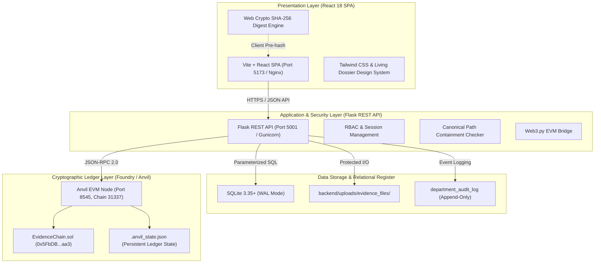
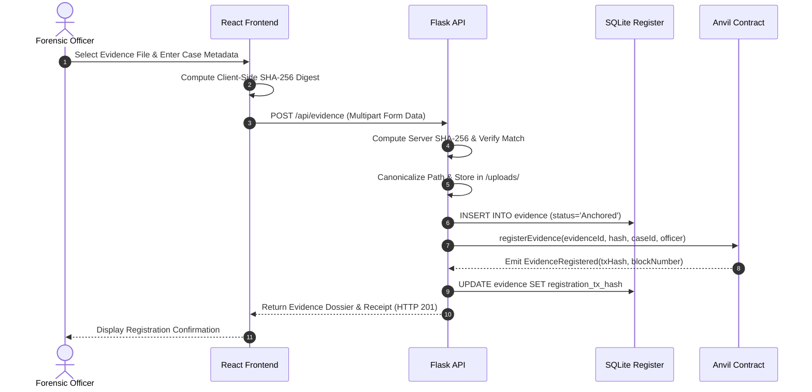
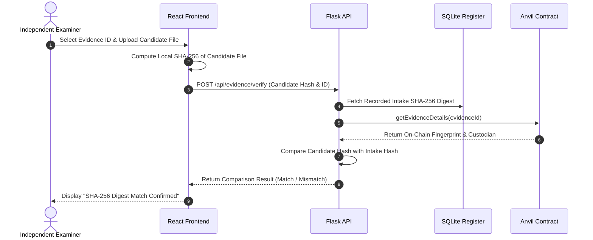

# EVIDENCECHAIN — PHASE 6: SYSTEM ARCHITECTURE SPECIFICATION

**Document ID:** EVC-P6-ARC-2026-FINAL  
**System Version:** Release Candidate 1.0  
**Classification:** Technical Architecture Reference  
**Date:** October 28, 2026  

---

## 1. High-Level System Architecture

EvidenceChain is engineered as a decoupled, multi-tiered digital forensics application combining a modern reactive web client, an authenticated RESTful application layer, a relational evidence register, and an Ethereum Virtual Machine (EVM) cryptographic anchoring state machine.



---

## 2. Multi-Tier Component Breakdown

### 2.1 Presentation Layer (Frontend SPA)
- **Framework:** React 18 with Vite build toolchain.
- **Styling:** Tailwind CSS implementing the approved "Living Dossier" institutional design language (refined dark slate `#0B1017` / `#161F2C` palette, subtle interactive borders, typography hierarchy).
- **Client-Side Cryptography:** Browser `crypto.subtle.digest("SHA-256", buffer)` generates immediate cryptographic fingerprints before uploading files, enabling local zero-knowledge verification.

### 2.2 Application Layer (Flask REST API)
- **Engine:** Python 3.10+ with Flask and Gunicorn WSGI.
- **Routing:** 22 secure endpoints supporting evidence intake, querying, verification, custody mutation, and diagnostic reporting.
- **Security Interceptors:** `@app.after_request` security headers, canonical `os.path.realpath` boundary validation, and secure session state serialization.

### 2.3 Relational Register (SQLite WAL Database)
- **Engine:** SQLite 3.35+ utilizing Write-Ahead Logging (`PRAGMA journal_mode=WAL`).
- **Core Entities:** `evidence`, `cases`, `users`, `case_assignments`, `department_audit_log`, `evidence_anchoring_events`.
- **Integrity Enforcement:** Foreign keys enabled, parameterized queries preventing SQL injection, strict schema validation.

### 2.4 Blockchain Layer (Foundry Anvil EVM)
- **Engine:** Foundry Anvil operating on private Chain ID `31337` with state persistence (`.anvil_state.json`).
- **Smart Contract:** `EvidenceChain.sol` compiled with Solidity 0.8.20 and deployed at `0x5FbDB2315678afecb367f032d93F642f64180aa3`.
- **Role:** Non-repudiable state machine for evidence registration, permission grants, custody transfers, and access events.

---

## 3. Core Data Flow Workflows

### 3.1 Evidence Registration & Ledger Anchoring



---

### 3.2 Independent Cryptographic Verification



---

## 4. Database Schema Specification

### 4.1 Table: `evidence`
Stores core forensic evidence asset records:

| Column | Type | Constraints | Description |
| :--- | :--- | :--- | :--- |
| `id` | INTEGER | PRIMARY KEY AUTOINCREMENT | Internal relational key |
| `evidence_id` | TEXT | UNIQUE NOT NULL | Human-readable ID (e.g., `EVD-25BB2C6B`) |
| `case_id` | TEXT | NOT NULL REFERENCES cases(case_id) | Parent case docket identifier |
| `title` | TEXT | NOT NULL | Descriptive title of digital asset |
| `description` | TEXT | NULLABLE | Detailed intake notes |
| `file_path` | TEXT | NOT NULL | Relative path within `UPLOAD_FOLDER` |
| `sha256_hash` | TEXT | NOT NULL | 64-character lowercase hex digest |
| `registered_by` | TEXT | NOT NULL | Address/Email of registering officer |
| `registration_tx_hash`| TEXT | NULLABLE | EVM transaction hash |
| `current_custodian` | TEXT | NOT NULL | Identity holding physical/digital custody |
| `created_at` | DATETIME| DEFAULT CURRENT_TIMESTAMP | Timestamp of initial record creation |
| `provenance_status` | TEXT | NOT NULL | `Historical Reference` or `Live Ledger` |

### 4.2 Table: `department_audit_log`
Append-only operational and security event audit trail:

| Column | Type | Constraints | Description |
| :--- | :--- | :--- | :--- |
| `id` | INTEGER | PRIMARY KEY AUTOINCREMENT | Monotonic log index |
| `timestamp` | DATETIME| DEFAULT CURRENT_TIMESTAMP | Standardized UTC timestamp |
| `user_email` | TEXT | NOT NULL | Authenticated user performing action |
| `action_type` | TEXT | NOT NULL | e.g. `VIEW_FILE`, `DOWNLOAD`, `REASSIGN` |
| `evidence_id` | TEXT | NULLABLE | Associated evidence record |
| `details` | TEXT | NOT NULL | JSON or narrative event metadata |

---

## 5. Smart Contract Interface (`EvidenceChain.sol`)

The Solidity contract exposes the following core functions:

```solidity
// Core Evidence Anchoring
function registerEvidence(
    string memory evidenceId,
    string memory fileHash,
    string memory caseId,
    address initialCustodian
) external onlyDepartmentHead;

// Access Management Gating
function grantViewAccess(
    string memory evidenceId,
    address grantee,
    uint256 expirationTime
) external onlyDepartmentHead;

function revokeViewAccess(
    string memory evidenceId,
    address grantee
) external onlyDepartmentHead;

// Zero-Trust Access Logging
function recordAccess(
    string memory evidenceId,
    string memory accessType
) external onlyAuthorized(evidenceId);

// Custody Transfer
function transferCustody(
    string memory evidenceId,
    address newCustodian,
    string memory notes
) external onlyCustodian(evidenceId);
```

---

## 6. Architectural Security Boundaries

1. **Boundary A (Browser Client to Flask API):** Session-authenticated via secure, HTTP-only cookies. No private keys reside in browser memory.
2. **Boundary B (Flask API to File Storage):** Strict canonical path isolation (`os.path.realpath`) preventing directory traversal outside `UPLOAD_FOLDER`.
3. **Boundary C (Flask API to SQLite):** Strictly parameterized SQL queries preventing SQL injection; write concurrency governed by SQLite WAL mode.
4. **Boundary D (Flask API to Anvil EVM):** Signed transactions dispatched via Web3.py over local loopback RPC (`127.0.0.1:8545`).
