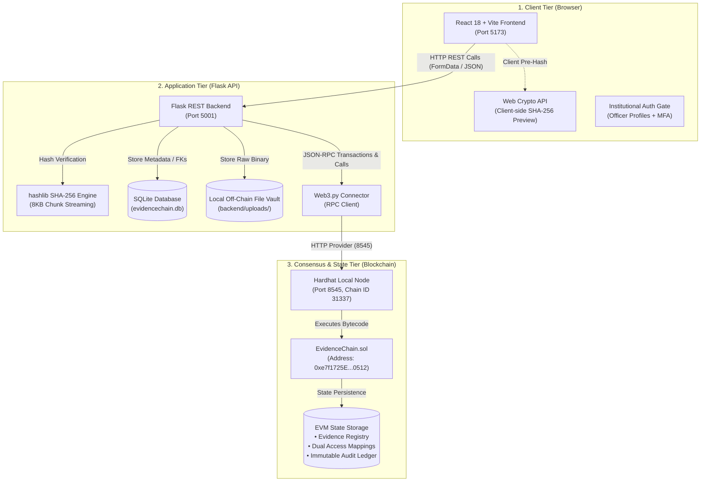
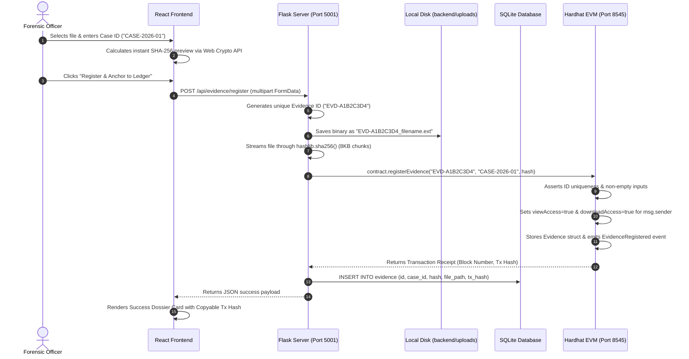
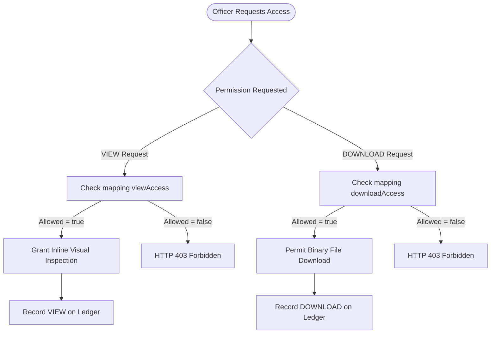

# EVIDENCECHAIN: COMPLETE TECHNICAL SPECIFICATION & SYSTEM WORKING MANUAL

> **Document Version:** 2.0 (Editorial Forensic Architecture Edition)  
> **Target Audience:** Systems Architects, Forensic Examiners, Legal Counsel, Frontend/Backend Developers, and AI Auditors  
> **Repository Root:** `~/Desktop/EvidenceChain`  
> **Tech Stack:** React 18, Vite, Python Flask, Web3.py, SQLite, Solidity 0.8.20, Hardhat Local EVM

---

## TABLE OF CONTENTS

1. [Executive Summary & Core Forensic Philosophy](#1-executive-summary--core-forensic-philosophy)
2. [High-Level Architecture & Component Topology](#2-high-level-architecture--component-topology)
3. [The Three Storage Tiers: Off-Chain vs. On-Chain vs. Metadata](#3-the-three-storage-tiers-off-chain-vs-on-chain-vs-metadata)
4. [Smart Contract Deep Dive (`EvidenceChain.sol`)](#4-smart-contract-deep-dive-evidencechainsol)
5. [Backend Architecture & REST API Specification (`app.py` & `blockchain.py`)](#5-backend-architecture--rest-api-specification)
6. [Frontend UI/UX Architecture & Component System](#6-frontend-uiux-architecture--component-system)
7. [Step-by-Step Minute Workflows](#7-step-by-step-minute-workflows)
   - 7.1 [Officer Authentication & Session Gate](#71-officer-authentication--session-gate)
   - 7.2 [Digital Evidence Intake & Registration Workflow](#72-digital-evidence-intake--registration-workflow)
   - 7.3 [Cryptographic Verification Workflow](#73-cryptographic-verification-workflow)
   - 7.4 [Dual-Permission Access Control (VIEW vs. DOWNLOAD)](#74-dual-permission-access-control-view-vs-download)
   - 7.5 [Secure Preview & Download Pipeline](#75-secure-preview--download-pipeline)
   - 7.6 [Non-Repudiable Immutable Audit Logging](#76-non-repudiable-immutable-audit-logging)
8. [Data Models & Schema Specifications](#8-data-models--schema-specifications)
9. [Forensic Legal Admissibility & Standards Compliance](#9-forensic-legal-admissibility--standards-compliance)
10. [Local Development, Deployment & Port Mapping](#10-local-development-deployment--port-mapping)

---

## 1. EXECUTIVE SUMMARY & CORE FORENSIC PHILOSOPHY

### The Problem in Traditional Digital Evidence Management
In conventional criminal investigations and corporate litigation, digital files (CCTV surveillance footage, hard drive forensics, intercepted communications, smartphone memory dumps) are stored in standard cloud storage buckets (AWS S3, Google Cloud Storage) or relational database servers. 

This traditional architecture introduces fatal legal vulnerabilities in court:
1. **Privileged Tampering:** A systems administrator or rogue employee with database write access can silently alter evidence files, timestamps, or custody logs without leaving an immutable audit trail.
2. **Repudiation:** An investigator can deny viewing or leaking sensitive evidence because centralized logs can be pruned or modified.
3. **Loss of Integrity:** If a defense attorney questions whether a video file was compressed or edited between seizure and courtroom trial, there is no mathematical proof that the file is bit-for-bit identical to the day it was seized.

### How EvidenceChain Solves This
EvidenceChain implements an **immutable, mathematically verifiable chain of custody** using a hybrid architecture:
- **Files are stored off-chain:** The raw binary evidence stays in a secure, local, off-chain storage repository to avoid blockchain bloat and cost.
- **Integrity is anchored on-chain:** A **SHA-256 cryptographic fingerprint** (digest) is calculated from the raw bytes and anchored permanently into an Ethereum Virtual Machine (EVM) smart contract alongside the Case ID, registering officer address, and block timestamp.
- **Strict Dual-Permission Access Control:** Access is segmented into two distinct rights: **VIEW** (inspection rights) and **DOWNLOAD** (physical file export). These rights are enforced on the smart contract itself.
- **Automatic Non-Repudiable Logging:** Every single time an officer opens a file or downloads it, the backend executes an on-chain transaction that logs the officer's wallet address, action, and timestamp directly into the blockchain ledger.

```
+-----------------------------------------------------------------------------------+
|                            EVIDENCECHAIN CORE PHILOSOPHY                          |
+-----------------------------------------------------------------------------------+
|  "Files reside in off-chain vaults; Integrity & Authority reside on the Ledger." |
+-----------------------------------------------------------------------------------+
```

---

## 2. HIGH-LEVEL ARCHITECTURE & COMPONENT TOPOLOGY

EvidenceChain is composed of three synchronized architectural tiers:



### Component Details
1. **Frontend (React 18 + Vite):** A responsive, single-page application built with modern hooks (`useState`, `useEffect`, `useRef`). It features a bespoke forensic editorial design system using `DM Serif Display`, `Manrope`, and `JetBrains Mono` fonts.
2. **Backend API (Python / Flask):** Handles multipart file uploads, cryptographic hashing, SQLite metadata persistence, and serves as the trusted bridge to the Ethereum node via `Web3.py`.
3. **Relational Metadata Store (SQLite):** Stores user profiles, titles, descriptions, and file paths. This keeps descriptive metadata readily searchable without paying blockchain gas fees.
4. **Blockchain Layer (Hardhat EVM / Solidity 0.8.20):** Runs an isolated Ethereum development node (`Chain ID 31337`). The `EvidenceChain.sol` contract serves as the ultimate source of truth for cryptographic hashes, ownership, permissions, and audit logs.

---

## 3. THE THREE STORAGE TIERS: OFF-CHAIN VS. ON-CHAIN VS. METADATA

A fundamental design decision of EvidenceChain is its **Tri-Tier Storage Model**:

| Property | Tier 1: Off-Chain File Vault | Tier 2: Relational SQLite DB | Tier 3: Blockchain State |
| :--- | :--- | :--- | :--- |
| **Location** | `backend/uploads/` on disk | `backend/evidencechain.db` | EVM contract storage (`0xe7f1...`) |
| **Data Stored** | Raw binary files (`.pdf`, `.png`, `.mp4`, `.docx`, `.txt`) | Evidence ID, Case ID, Title, Description, File Path, Foreign Keys | Evidence ID, Case ID, SHA-256 Hash string, Owner address, Timestamp, Permissions, Audit logs |
| **Why here?** | Storing megabytes or gigabytes on-chain is computationally impossible and cost-prohibitive. | Enables instantaneous full-text search, filtering, and rapid UI pagination. | Provides mathematical non-repudiation, tamper-detection, and decentralized access rules. |
| **Mutability** | Mutable at the OS level (but tampering is immediately caught by verification). | Mutable by application server. | **Strictly Immutable:** once written to a block, it can never be edited or deleted. |

---

## 4. SMART CONTRACT DEEP DIVE (`EvidenceChain.sol`)

The smart contract is written in **Solidity ^0.8.20** and compiled using Hardhat. It contains zero external library dependencies, maximizing security and minimizing gas usage.

### 4.1 State Variables and Mappings

```solidity
// Core Evidence Registry: maps evidence ID string -> Evidence struct
mapping(string => Evidence) public evidences;

// Non-repudiable audit trail: maps evidence ID -> dynamic array of AccessRecord
mapping(string => AccessRecord[]) public accessHistory;

// View permission: maps evidenceId -> (userAddress -> bool)
mapping(string => mapping(address => bool)) public viewAccess;

// Download permission: maps evidenceId -> (userAddress -> bool)
mapping(string => mapping(address => bool)) public downloadAccess;
```

### 4.2 Data Structures (Structs)

```solidity
struct Evidence {
    string evidenceId;       // e.g. "EVD-DFE7F414"
    string caseId;           // e.g. "CASE-REFINEMENT-001"
    string evidenceHash;     // 64-character lowercase SHA-256 hex string
    address registeredBy;    // Ethereum address of registering officer
    uint256 timestamp;       // Block timestamp (Unix epoch seconds)
}

struct AccessRecord {
    address accessedBy;      // Officer who triggered the action
    string action;           // "VIEW" or "DOWNLOAD"
    uint256 timestamp;       // Block timestamp
}
```

### 4.3 Contract Events

Every state mutation emits an indexed event into the Ethereum transaction receipt logs:
- `event EvidenceRegistered(string evidenceId, string caseId, string evidenceHash, address registeredBy, uint256 timestamp)`
- `event ViewAccessGranted(string evidenceId, address user, address grantedBy, uint256 timestamp)`
- `event ViewAccessRevoked(string evidenceId, address user, address revokedBy, uint256 timestamp)`
- `event DownloadAccessGranted(string evidenceId, address user, address grantedBy, uint256 timestamp)`
- `event DownloadAccessRevoked(string evidenceId, address user, address revokedBy, uint256 timestamp)`
- `event EvidenceAccessed(string evidenceId, address accessedBy, string action, uint256 timestamp)`

### 4.4 Function Inventory & Implementation Logic

| Function Name | State Mutability | Access Modifier | Description |
| :--- | :--- | :--- | :--- |
| `registerEvidence(_id, _case, _hash)` | Non-payable (writes state) | Public | Verifies evidence does not already exist, instantiates `Evidence` struct, and automatically grants both `viewAccess` and `downloadAccess` to `msg.sender`. |
| `getEvidence(_id)` | `view` (read-only) | Public | Returns the `Evidence` struct tuple `(evidenceId, caseId, evidenceHash, registeredBy, timestamp)`. |
| `verifyEvidence(_id, _currentHash)` | `view` (read-only) | Public | Compares `keccak256(storedHash)` with `keccak256(currentHash)` and returns `true` or `false`. |
| `grantViewAccess(_id, _user)` | Non-payable | `onlyEvidenceOwner` | Sets `viewAccess[_id][_user] = true` and emits `ViewAccessGranted`. |
| `revokeViewAccess(_id, _user)` | Non-payable | `onlyEvidenceOwner` | Sets `viewAccess[_id][_user] = false` and emits `ViewAccessRevoked`. |
| `grantDownloadAccess(_id, _user)` | Non-payable | `onlyEvidenceOwner` | Sets `downloadAccess[_id][_user] = true` and emits `DownloadAccessGranted`. |
| `revokeDownloadAccess(_id, _user)`| Non-payable | `onlyEvidenceOwner` | Sets `downloadAccess[_id][_user] = false` and emits `DownloadAccessRevoked`. |
| `canView(_id, _user)` | `view` | Public | Returns boolean indicating if `_user` holds active VIEW rights. |
| `canDownload(_id, _user)` | `view` | Public | Returns boolean indicating if `_user` holds active DOWNLOAD rights. |
| `recordAccess(_id, _action)` | Non-payable | Public | Validates `_action` is either "VIEW" or "DOWNLOAD". Enforces that `msg.sender` has the required active right in `viewAccess` or `downloadAccess`. Appends `AccessRecord` to `accessHistory[_id]` and emits `EvidenceAccessed`. |
| `getAccessHistory(_id)` | `view` | Public | Returns the entire array of `AccessRecord` structs for that evidence. |

---

## 5. BACKEND ARCHITECTURE & REST API SPECIFICATION

The backend is built in Python using Flask (`app.py`), Web3.py (`blockchain.py`), and SQLite3 (`database/db.py`).

### 5.1 The SHA-256 Hashing Engine
To ensure that large video or disk image files do not consume excessive server RAM, `app.py` computes hashes using an 8192-byte chunk streaming loop:

```python
def calculate_sha256(file_path):
    sha256 = hashlib.sha256()
    with open(file_path, "rb") as file:
        while True:
            chunk = file.read(8192)
            if not chunk:
                break
            sha256.update(chunk)
    return sha256.hexdigest()
```

### 5.2 Complete REST Endpoint Reference

#### 1. System Health
- **Endpoint:** `GET /api/health`
- **Description:** Verifies that the Flask backend process is active.
- **Response:**
  ```json
  { "status": "ok", "service": "EvidenceChain Backend" }
  ```

#### 2. List All Evidence
- **Endpoint:** `GET /api/evidence`
- **Description:** Returns all registered digital evidence items from SQLite ordered by descending ID.
- **Response:**
  ```json
  {
    "status": "success",
    "count": 12,
    "evidence": [
      {
        "evidenceId": "EVD-DFE7F414",
        "caseId": "CASE-REFINEMENT-001",
        "title": "final_demo_evidence.txt",
        "description": "Forensic reference evidence",
        "filePath": "/Users/.../backend/uploads/EVD-DFE7F414_final_demo_evidence.txt",
        "sha256Hash": "f013fc8175b9f8f4fbe29a244498305c486e9fe0fd4a0c8681283d50d52c2a0f",
        "registeredBy": "0xf39Fd6e51aad88F6F4ce6aB8827279cffFb92266",
        "blockchainEvidenceId": "EVD-DFE7F414",
        "registrationTxHash": "0x367f08d0a852a32ec693bb444c5409daecff195655767ebaa5fec349a5b3f7f0",
        "createdAt": "2026-09-24 04:44:41"
      }
    ]
  }
  ```

#### 3. Register New Evidence
- **Endpoint:** `POST /api/evidence/register`
- **Content-Type:** `multipart/form-data`
- **Parameters:**
  - `file`: Raw binary file (required)
  - `caseId`: String docket identifier, e.g. "CASE-2026-88" (required)
  - `description`: String description of evidence contents (optional)
- **Execution Flow:**
  1. Validates presence of file and `caseId`.
  2. Generates unique ID: `"EVD-" + uuid.uuid4().hex[:8].upper()`.
  3. Saves file to disk as `{evidence_id}_{original_filename}`.
  4. Runs `calculate_sha256(file_path)`.
  5. Executes smart contract function `registerEvidence(evidence_id, case_id, hash)`.
  6. Waits for transaction receipt and extracts block number and transaction hash.
  7. Inserts full record into SQLite `evidence` table.
- **Response:** HTTP 201 / 200 with transaction receipt details.

#### 4. Cryptographic Verification
- **Endpoint:** `POST /api/evidence/<evidence_id>/verify`
- **Content-Type:** `application/json`
- **Body:** `{ "currentHash": "f013fc81..." }`
- **Execution Flow:**
  1. Queries on-chain hash via `get_evidence(evidence_id)`.
  2. Invokes smart contract `verifyEvidence(evidence_id, currentHash)`.
  3. Returns comparison result.
- **Response:**
  ```json
  {
    "status": "success",
    "evidenceId": "EVD-DFE7F414",
    "result": "AUTHENTIC",
    "isAuthentic": true,
    "storedHash": "f013fc81...",
    "providedHash": "f013fc81..."
  }
  ```

#### 5. Check Permissions
- **Endpoints:**
  - `POST /api/evidence/<evidence_id>/view-access`
  - `POST /api/evidence/<evidence_id>/download-access`
- **Body:** `{ "userAddress": "0x70997970C51812dc3A010C7d01b50e0d17dc79C8" }`
- **Response:**
  ```json
  {
    "status": "success",
    "evidenceId": "EVD-DFE7F414",
    "userAddress": "0x70997970C51812dc3A010C7d01b50e0d17dc79C8",
    "canView": true
  }
  ```

#### 6. Grant & Revoke Permissions
- **Endpoints:**
  - `POST /api/evidence/<evidence_id>/view-access/grant`
  - `POST /api/evidence/<evidence_id>/view-access/revoke`
  - `POST /api/evidence/<evidence_id>/download-access/grant`
  - `POST /api/evidence/<evidence_id>/download-access/revoke`
- **Body:** `{ "userAddress": "0x7099..." }`
- **Authorization:** Enforces that the caller is the registered evidence owner on the smart contract (`onlyEvidenceOwner`).
- **Response:** Returns on-chain transaction hash and block number confirming privilege update.

#### 7. Secure Preview (Inline Streaming)
- **Endpoint:** `GET /api/evidence/<evidence_id>/view?userAddress=0x...`
- **Execution Flow:**
  1. Calls `can_view(evidence_id, user_address)`.
  2. If false, terminates with HTTP 403 Forbidden.
  3. If true, invokes `record_access(evidence_id, "VIEW", user_address)` on-chain.
  4. Returns file using Flask `send_file(file_path, as_attachment=False)`.

#### 8. Secure File Download
- **Endpoint:** `GET /api/evidence/<evidence_id>/download?userAddress=0x...`
- **Execution Flow:**
  1. Calls `can_download(evidence_id, user_address)`.
  2. If false, terminates with HTTP 403 Forbidden.
  3. If true, invokes `record_access(evidence_id, "DOWNLOAD", user_address)` on-chain.
  4. Returns file using Flask `send_file(file_path, as_attachment=True, download_name=...)`.

#### 9. Query Access Audit Trail
- **Endpoint:** `GET /api/evidence/<evidence_id>/access-history`
- **Description:** Directly queries the Ethereum smart contract's `accessHistory` mapping.
- **Response:**
  ```json
  {
    "status": "success",
    "count": 1,
    "evidenceId": "EVD-DFE7F414",
    "accessHistory": [
      {
        "accessedBy": "0x70997970C51812dc3A010C7d01b50e0d17dc79C8",
        "action": "VIEW",
        "timestamp": "1790225218"
      }
    ]
  }
  ```

---

## 6. FRONTEND UI/UX ARCHITECTURE & COMPONENT SYSTEM

The frontend is engineered as an authoritative **Institutional Forensic Operations Console**, avoiding generic AI-generated aesthetics.

### 6.1 Design Tokens & Forensic Color Palette

```css
:root {
  /* Archival Matte Canvas */
  --bg-primary: #F4F1EA;       /* Warm Bone canvas */
  --bg-secondary: #EAE5DA;     /* Soft Sand header/sidebar tint */
  --bg-surface: #FCFBF8;       /* Warm White document dossier surface */
  
  /* Authoritative Inks */
  --text-primary: #142535;     /* Deep Ink Navy */
  --text-secondary: #304657;   /* Slate Blue */
  --border-subtle: #D8D3C8;    /* 1px Archival Rule Divider */
  
  /* Dual Permission System */
  --accent-teal: #087E78;      /* VIEW Permissions & Verification match */
  --accent-copper: #B56A3A;    /* DOWNLOAD Permissions & High-impact alerts */
  
  /* Forensic Status */
  --status-success: #287A58;   /* Forest Emerald (Bitwise authentic) */
  --status-danger: #B84040;    /* Brick Crimson (Hash divergence / Revoked) */
}
```

### 6.2 Typography Hierarchy
- **`DM Serif Display`**: Used for authoritative titles, case docket numbers, and verification seals. Evokes legal gazettes and high-court registries.
- **`Manrope`**: Modern, highly legible humanist sans-serif used for table columns, form labels, and navigation.
- **`JetBrains Mono`**: Monospaced font reserved exclusively for cryptographic digests, EVM hex addresses, and block heights.

### 6.3 Complete Frontend View Directory

```
frontend/src/
├── App.jsx                     # Master Controller & Routing State
├── App.css                     # Editorial Forensic Design System & Keyframes
├── api.js                      # Centralized REST API Client
├── components/
│   ├── Header.jsx              # Institutional Header & Live Network Status
│   ├── Sidebar.jsx             # Architectural Navigation Bar with Badges
│   ├── LoginModal.jsx          # Quick-Switch Identity & Credential Modal
│   └── Icons.jsx               # Precision SVG Iconography
└── views/
    ├── LoginView.jsx           # Dedicated Authentication Gateway
    ├── DashboardView.jsx       # Asymmetric Metric Strip & Pipeline
    ├── EvidenceListView.jsx    # Forensic Docket Table with Dual Badges
    ├── RegisterEvidenceView.jsx# 4-Step Intake with Client-side Hashing
    ├── VerifyEvidenceView.jsx  # Real-Time Bitwise Comparator
    ├── EvidenceDetailsView.jsx # Evidentiary Dossier & Inline Viewer
    ├── AccessManagementView.jsx# Dual Permission Matrix & Consequence Modal
    ├── AccessHistoryView.jsx   # Non-Repudiable Smart Contract Ledger
    ├── IdentityProfileView.jsx # Cryptographic Officer Credentials
    └── SystemStatusView.jsx    # Infrastructure Node Telemetry
```

---

## 7. STEP-BY-STEP MINUTE WORKFLOWS

### 7.1 Officer Authentication & Session Gate
1. **Initial Visit (`http://localhost:5173/`):** The application mounts with `isAuthenticated = false`. The master controller in `App.jsx` evaluates the gate condition and immediately renders `LoginView.jsx`.
2. **Identity Verification:** The user can either input their official departmental credentials (`OFF-1024` + password) and click **Advance to Security Key / MFA Verification**, or select one of three **Pre-Configured Officer Personas**:
   - *Officer Rahul Sharma:* Lead Forensic Investigator (`Full Privileges: VIEW + DOWNLOAD`).
   - *Officer Ananya Patel:* Forensic Analyst (`VIEW Allowed, DOWNLOAD Restricted`).
   - *Officer Vikram Mehta:* Defense Examiner (`Restricted / Pending Authorization`).
3. **Session Instantiation:** The selected profile is set into React state (`currentUser`), `isAuthenticated` flips to `true`, and the interface executes a smooth `@keyframes viewFadeSlide` transition into `DashboardView.jsx`.

---

### 7.2 Digital Evidence Intake & Registration Workflow
When an officer registers a piece of evidence:



---

### 7.3 Cryptographic Verification Workflow
When an investigator or defense attorney wishes to verify if a file has been tampered with:
1. **Intake on `VerifyEvidenceView.jsx`:** The user selects the suspect file from their computer and inputs the claimed Evidence ID (e.g. `EVD-DFE7F414`).
2. **Client-Side Digest:** The browser immediately reads the file array buffer and computes the `currentHash`.
3. **Backend Query:** The frontend calls `POST /api/evidence/EVD-DFE7F414/verify` passing `{ currentHash }`.
4. **On-Chain Extraction:** The Flask backend calls `contract.functions.getEvidence("EVD-DFE7F414").call()`. This extracts the original `evidenceHash` anchored at the time of initial seizure.
5. **Bitwise Comparison:** 
   - The contract calls `verifyEvidence(evidenceId, currentHash)` which performs:
     ```solidity
     keccak256(bytes(evidences[_evidenceId].evidenceHash)) == keccak256(bytes(_currentHash))
     ```
6. **Verdict Display:**
   - **MATCH CONFIRMED (`AUTHENTIC`):** The interface renders a Forest Emerald seal verifying zero-byte modification.
   - **FINGERPRINT MISMATCH (`TAMPERED`):** The interface displays a high-visibility Brick Crimson banner showing the original blockchain hash side-by-side with the suspect hash, warning that the evidence has been altered.

---

### 7.4 Dual-Permission Access Control (VIEW vs. DOWNLOAD)
In forensic science, the **principle of least privilege** dictates that viewing evidence should not grant the right to extract and duplicate it. 

EvidenceChain enforces this on the smart contract:



#### The Technical Consequence Modal
When an owner navigates to `AccessManagementView.jsx` to grant or revoke rights:
1. Clicking **Grant View** or **Revoke Download** opens an interactive confirmation dialog.
2. The modal details the exact cryptographic consequences:
   - *On-Chain Transaction:* Submits a state-modifying transaction to the EVM requiring gas.
   - *Endpoint Enforcement:* Instantly closes or opens the Flask streaming route.
   - *Audit Trail Impact:* Emits an on-chain event (`ViewAccessGranted` / `DownloadAccessRevoked`) that cannot be deleted.

---

### 7.5 Secure Preview & Download Pipeline
1. When viewing a file in `EvidenceDetailsView.jsx`, the frontend calls `GET /api/evidence/<id>/view?userAddress=0x...`.
2. Flask checks the smart contract:
   ```python
   allowed = can_view(evidence_id, user_address)
   if not allowed:
       return jsonify({"error": "View access denied."}), 403
   ```
3. Flask records the access on-chain:
   ```python
   record_access(evidence_id, "VIEW", user_address)
   ```
4. Flask streams the file bytes directly to the browser for inline rendering (image, text, PDF).
5. The same sequence applies to `GET /api/evidence/<id>/download`, which enforces `can_download` and records a `"DOWNLOAD"` action before returning the file as an attachment.

---

### 7.6 Non-Repudiable Immutable Audit Logging
1. Whenever `record_access(evidenceId, action, userAddress)` is called:
2. The contract executes:
   ```solidity
   accessHistory[_evidenceId].push(
       AccessRecord(msg.sender, _action, block.timestamp)
   );
   emit EvidenceAccessed(_evidenceId, msg.sender, _action, block.timestamp);
   ```
3. Because this is saved in EVM storage, **no database administrator, developer, or officer can erase an entry**.
4. In `AccessHistoryView.jsx`, the complete history is fetched directly from the smart contract (`getAccessHistory`), translating Unix epoch timestamps into human-readable legal timestamps (e.g. `2026-09-24 10:16:58 UTC`).

---

## 8. DATA MODELS & SCHEMA SPECIFICATIONS

### 8.1 SQLite Relational Schema (`evidencechain.db`)

```sql
CREATE TABLE IF NOT EXISTS users (
    id INTEGER PRIMARY KEY AUTOINCREMENT,
    name TEXT NOT NULL,
    email TEXT UNIQUE NOT NULL,
    password_hash TEXT NOT NULL,
    role TEXT NOT NULL,
    wallet_address TEXT,
    created_at TIMESTAMP DEFAULT CURRENT_TIMESTAMP
);

CREATE TABLE IF NOT EXISTS evidence (
    id INTEGER PRIMARY KEY AUTOINCREMENT,
    evidence_id TEXT UNIQUE NOT NULL,
    case_id TEXT NOT NULL,
    title TEXT,
    description TEXT,
    file_path TEXT,
    sha256_hash TEXT NOT NULL,
    registered_by INTEGER,
    blockchain_evidence_id TEXT,
    registration_tx_hash TEXT,
    current_custodian TEXT,
    created_at TIMESTAMP DEFAULT CURRENT_TIMESTAMP,
    FOREIGN KEY (registered_by) REFERENCES users(id)
);
```

---

## 9. FORENSIC LEGAL ADMISSIBILITY & STANDARDS COMPLIANCE

EvidenceChain was designed to meet strict international standards for digital evidence admissibility:

1. **US Federal Rules of Evidence (FRE) Rule 902(13) & 902(14):**
   - Covers self-authenticating records generated by an electronic process or system.
   - EvidenceChain fulfills this via deterministic SHA-256 hashing and mathematical verification against an immutable ledger.
2. **Indian Evidence Act (Section 65B Certification):**
   - Requires proof that electronic devices operated properly and that files were not tampered with during storage.
   - The on-chain immutable timestamp and smart contract access history serve as verifiable electronic certificates of custody.
3. **ISO/IEC 27037 (Guidelines for identification, collection, acquisition, and preservation of digital evidence):**
   - Mandates that the digital chain of custody must account for every individual who accessed or handled the evidence. EvidenceChain automates this at the protocol layer via `recordAccess()`.

---

## 10. LOCAL DEVELOPMENT, DEPLOYMENT & PORT MAPPING

### Runtime Environment Map

| Component | Port | Network Interface | Process Name | Working Directory |
| :--- | :--- | :--- | :--- | :--- |
| **Hardhat EVM Node** | `8545` | `127.0.0.1` / `localhost` | `node` (npx hardhat node) | `~/Desktop/EvidenceChain` |
| **Flask REST API** | `5001` | `127.0.0.1` | `Python` (`python app.py`) | `~/Desktop/EvidenceChain/backend` |
| **Vite Frontend Dev**| `5173` | `localhost` | `node` (`npm run dev`) | `~/Desktop/EvidenceChain/frontend` |

### Step-by-Step Environment Startup

#### Terminal 1: Blockchain Node
```bash
cd ~/Desktop/EvidenceChain
npx hardhat node
```
*Outputs accounts and begins listening on `http://127.0.0.1:8545` (Chain ID 31337).*

#### Terminal 2: Smart Contract Deployment (If Re-deploying)
```bash
cd ~/Desktop/EvidenceChain
npx hardhat run scripts/deploy.js --network localhost
```
*Configured in `backend/blockchain.py` at `0xe7f1725E7734CE288F8367e1Bb143E90bb3F0512`.*

#### Terminal 3: Flask Backend
```bash
cd ~/Desktop/EvidenceChain/backend
source venv/bin/activate
python -c "from app import app; app.run(host='127.0.0.1', port=5001, debug=True)"
```

#### Terminal 4: React Frontend
```bash
cd ~/Desktop/EvidenceChain/frontend
npm run dev
```
*Access application in browser at `http://localhost:5173`.*

---

## 11. SUMMARY & CONCLUSION

EvidenceChain solves the fundamental flaw of digital forensic custody by separating raw data storage from cryptographic integrity anchoring. By enforcing fine-grained **VIEW** versus **DOWNLOAD** permissions directly on an Ethereum smart contract and automating non-repudiable access audit records, the system provides prosecutors, defense attorneys, and judges with mathematical certainty that digital evidence presented in court is pristine, authentic, and untampered.
