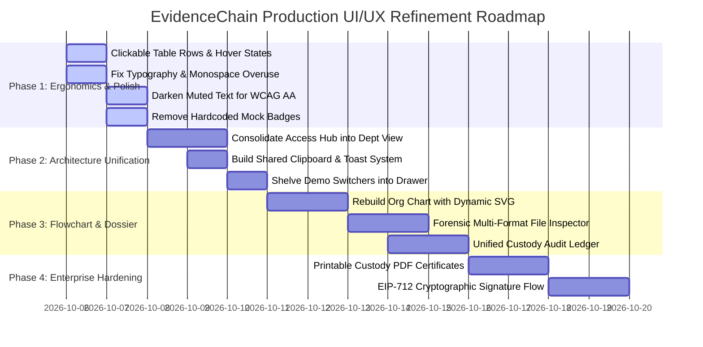

# EvidenceChain — Brutal UI/UX, Visual Design, Product Quality & Vibe-Coding Audit

**Target System**: EvidenceChain — Blockchain-Based Digital Evidence Chain of Custody System  
**Audit Date**: October 5, 2026  
**Auditor Roles**: Senior Product Designer • Principal UI/UX Architect • Digital Forensics Specialist • Usability & Accessibility Auditor  
**Runtime Environment**: React 18.2 (Vite :5173) • Flask Gateway (:5001) • Hardhat EVM Node (Chain ID 31337, :8545)  
**Contract Address**: `0x5FbDB2315678afecb367f032d93F642f64180aa3`  

---

## SECTION A: Brutal Verdict

If EvidenceChain were evaluated today by a senior digital forensics laboratory director, a state prosecutor’s cybercrime liaison, or an enterprise design systems architect, the verdict would be **uncomfortable but unequivocal**:

> **"Technically impressive cryptographic plumbing trapped inside an uncanny AI-generated cardboard cutout of institutional software."**

EvidenceChain demonstrates exceptional backend and smart contract mechanics: real SHA-256 binary hashing via the WebCrypto API, strict off-chain file storage with SQLite metadata, on-chain dual-permission gates (independent `VIEW` and `DOWNLOAD` privileges), and non-repudiable audit event logs. **The math and logic work.**

However, the user experience does not feel like high-stakes forensic software used in criminal proceedings. It feels like **an AI prompt's literal interpretation of 'forensic editorial aesthetic.'**

The interface is trapped in a **"paper-and-borders" straightjacket**:
- A mud-and-linen palette (`#F1EFE8`, `#E7E3D9`, `#DCD7CB`) that lacks functional contrast and visual hierarchy.
- An obsession with wrapping every single element in 1px borders with 2px corner radii ("box-in-a-box-in-a-box" syndrome).
- Heavy misuse of monospace typography (`IBM Plex Mono`) for static table headers, buttons, navigation indices, and micro-labels, turning human workflows into a cryptographic terminal parody.
- Duplicated identity telemetry across four simultaneous UI regions (Sidebar footer, Header, Persona Switcher strip, and Account modal).
- Redundant and conflicting information architecture (e.g., *Access Management* vs *Department Authority Matrix*, and *Access History* vs *Administrative Audit Register*).
- An intrusive "evaluator demo switcher" rendered front-and-center inside operational views, destroying any illusion of enterprise security or courtroom admissibility.

The software functions correctly, but **trust is visual and ergonomic before it is cryptographic**. If a defense attorney or a forensic supervisor sat in front of this UI, they would not see a hardened, battle-tested law enforcement tool; they would see a prototype that was "vibe-coded" with an LLM in a single weekend.

---

## SECTION B: Scorecard (18 Categories Scored 1–10)

| # | Evaluation Category | Score | Justification & Concrete Evidence |
| :---: | :--- | :---: | :--- |
| **1** | **First Impression & Visual Identity** | **5.5 / 10** | The parchment/archival theme (`#F1EFE8`) is an interesting departure from generic Tailwind/Inter dashboards, but it looks sickly pale, flat, and washed out under real lighting. The logo is plain bold serif text without a distinctive mark or badge. |
| **2** | **Information Hierarchy & Layout** | **4.5 / 10** | Excessive visual competing planes. Screens suffer from nested containment: page wrapper inside canvas, doc panel inside page, table inside doc panel, chips inside table cells. Eye tracking is scattered across five competing border lines. |
| **3** | **Typography & Readability** | **5.0 / 10** | `IBM Plex Sans` + `IBM Plex Serif` + `IBM Plex Mono`. Good font pairings in theory, ruined by execution: uppercase micro-labels with `letter-spacing: 0.8px` are plastered everywhere, while `IBM Plex Mono` is overused on elements that are not hashes or addresses (e.g., buttons, timestamps, nav numbers). |
| **4** | **Color System & Status Indicators** | **4.0 / 10** | Low-contrast swamp. Borders (`#C9C5BA` on `#E7E3D9`) fail WCAG 2.1 AAA contrast guidelines. Accent colors (`#34594A` green, `#967447` ochre, `#963F38` red) are heavily desaturated, making critical security warnings look like faint archival stamps rather than alert states. |
| **5** | **Spacing, Alignment & Rhythm** | **5.5 / 10** | Spacing feels haphazardly hardcoded (`padding: 10px 12px`, `padding: 16px`, `gap: 6px`, `gap: 14px`). Vertical rhythm lacks an underlying 4px/8px baseline grid, leading to compressed forms and needlessly tall table rows. |
| **6** | **Component Consistency & System Maturity** | **4.0 / 10** | Components are written as repetitive inline JSX idioms across views rather than reusable compound components. Modal logic, copy buttons, hash formatters, and status chips are re-implemented with minor style variations in almost every view. |
| **7** | **Form Design & Input Ergonomics** | **5.0 / 10** | Inputs (`.form-input-text`) use flat borders and light backgrounds that blend into surrounding containers. Drag-and-drop file targets lack visual depth and micro-animations during drag-over events. Keyboard navigation on file inputs is clunky. |
| **8** | **Table & Data Display Design** | **5.5 / 10** | Tables are clean and legible, but entirely non-interactive: clicking a row does nothing (users must hunt down the tiny `DOSSIER` button). Pagination, multi-column sorting, column resizing, and bulk actions are completely missing. |
| **9** | **Empty States, Loading & Errors** | **4.0 / 10** | Empty states are raw text centered in a div (`"No access events recorded..."`). Loading states use crude `"Loading..."` or `"Syncing..."` button labels without skeleton loaders, progressive loading, or optimistic UI updates. |
| **10** | **Feedback, Alerts & System Messaging** | **4.5 / 10** | Alerts are full-width yellow/red warning boxes (`.banner-alert`) that push content down abruptly. There is no non-intrusive toast system for transient successes (e.g., "Copied to clipboard" relies on local state timers replacing button text). |
| **11** | **Responsive Design & Mobile Usability** | **3.5 / 10** | Below 900px, the UI collapses: the sidebar is fixed at `256px` or forced to stack, the department flowchart connector lines break into disjointed orphan line segments, and data tables trigger horizontal scrollbars with cutoff actions. |
| **12** | **Accessibility (WCAG 2.1 AA/AAA)** | **4.0 / 10** | Muted labels (`#82867F` on `#E7E3D9`) fail WCAG AA color contrast (contrast ratio ~2.8:1, well below the required 4.5:1). Interactive elements rely on visual color alone without sufficient screen reader `aria-live` or `aria-expanded` attributes. |
| **13** | **Micro-Interactions & Transition Feel** | **3.0 / 10** | `App.css` explicitly enforces `box-shadow: none !important; text-shadow: none !important; transition: none`. While intended to look "restrained and institutional," it results in a dead, unresponsive, wooden feel. Buttons feel like paper stickers. |
| **14** | **Cognitive Load & Task Efficiency** | **4.5 / 10** | High cognitive overhead. Users must decipher where to execute permissions: the *Department Authority Matrix* or the *Access Management* view? Both perform grant/revoke actions on the exact same smart contract. |
| **15** | **Forensic/Legal Domain Appropriateness** | **6.0 / 10** | The language and data fields (*Chain of Custody*, *SHA-256*, *Non-Repudiation*, *Dossier*, *Bitwise Match*) are domain-accurate. However, the presence of demo buttons like `"HOD: Dr. Rajeshwar Sen"` destroys courtroom credibility. |
| **16** | **Vibe-Coding Smell Test** | **3.0 / 10** | Screams AI-generated. The code has classic LLM artifacts: repeating 64-char hex strings with slice expressions, identical doc-panel card templates across 11 files, hardcoded demo arrays, and defensive CSS resets (`* { box-shadow: none !important; }`). |
| **17** | **Production Readiness (UX/Design)** | **3.5 / 10** | Not ready for enterprise deployment. An actual forensic lab would reject this for lack of audit filtering, lack of exportable PDF custody certificates, lack of session timeout warnings, and lack of real Web3 wallet signature modals (EIP-712). |
| **18** | **Emotional Response & Trust Factor** | **5.0 / 10** | Users feel that the system is technically competent under the hood, but nervous that the interface is brittle, synthetic, and fabricated for a tech demo rather than daily law enforcement operations. |

**Overall Mean Score: 4.47 / 10** *(Functional Prototype Stage; Substantial UX Refactoring Required for Enterprise Production)*

---

## SECTION C: Top 10 Critical Problems

### 1. Architectural Duplication: Dual Conflicting Permission Management Hubs
- **Location**: `DepartmentAuthorityView.jsx` (Lines 770–860) and `AccessManagementView.jsx` (Lines 180–320).
- **Why It Matters**: There are two distinct top-level navigation items: *Department Authority* (`05`) and *Access Management* (`06`). Both screens query the same contracts, present granting/revoking controls for `VIEW` and `DOWNLOAD` permissions, and alter the exact same state. A forensic user is left confused about which screen is the authoritative command center.
- **Root Cause Fix**: Consolidate into a single unified security domain. Deprecate `AccessManagementView` as an independent page; fold its granular address-lookup utility into a modal or drawer within `DepartmentAuthorityView`.
- **Priority**: P0 (Immediate) | **Effort**: Medium

### 2. Hardcoded Mock Badges in Evidence Repository
- **Location**: `EvidenceListView.jsx` (Lines 212–219).
- **Why It Matters**: In the master repository table, every single record renders:
  ```jsx
  <span className="badge-clean badge-verified">VIEW: ALLOWED</span>
  <span className="badge-clean badge-pending">DL: CONTROLLED</span>
  ```
  This is hardcoded static HTML! It does not inspect the active user's permissions. If Officer Vikram (who has 0 permissions) logs in, the repository still falsely displays `VIEW: ALLOWED`. This is a severe integrity flaw in a forensics system.
- **Root Cause Fix**: Dynamically evaluate user permissions or display an unopinionated column showing total authorized personnel count (`e.g., 2 Authorized Officers`), deferring individual access resolution to the detail view.
- **Priority**: P0 (Immediate) | **Effort**: Low

### 3. Non-Interactive Table Rows (Click Targets Restricted to 11px Buttons)
- **Location**: `EvidenceListView.jsx` (Lines 163–255) and `DashboardView.jsx` (Lines 140–200).
- **Why It Matters**: Standard enterprise ergonomics dictate that clicking anywhere on a table row navigates to that record's primary detail view. In EvidenceChain, table rows are completely inert (`cursor: default`). Users are forced to precisely aim and click the tiny `DOSSIER` button in the final column.
- **Root Cause Fix**: Add `onClick={() => onSelectEvidence(item.evidenceId)}` to the `<tr>` element, style with subtle row hover background (`#EBE7DC`), and make action buttons stop propagation (`e.stopPropagation()`).
- **Priority**: P1 (High) | **Effort**: Low

### 4. Fragile Flowchart Connectors in Department Hierarchy
- **Location**: `DepartmentAuthorityView.jsx` (Lines 572–576) and `App.css` (Lines 1005–1045).
- **Why It Matters**: The flowchart tree is built with rigid CSS divs (`.connector-vertical-line`, `.connector-horizontal-bar`, `.connector-vertical-drop`). When the screen width narrows or when more than 3 subordinate officers exist, flexbox wraps the member cards onto a second row. The horizontal connector bar floats awkwardly in empty white space, disconnected from the cards below it.
- **Root Cause Fix**: Replace static CSS divs with an inline SVG tree or a resilient CSS grid pseudo-element architecture (`::before` / `::after` tree brackets per card node).
- **Priority**: P1 (High) | **Effort**: Medium

### 5. Exposed Evaluator Persona Switchers Inside Operational Interfaces
- **Location**: `DepartmentAuthorityView.jsx` (Lines 431–513) and `Sidebar.jsx` (Line 180).
- **Why It Matters**: Having buttons like `"HOD: Dr. Rajeshwar Sen"` and `"Investigator: Rahul"` permanently pinned to the top of an operational command screen shatters institutional realism. In a real police department, an officer cannot click a button on their screen to suddenly become the Head of Department.
- **Root Cause Fix**: Move all evaluation and demo persona switching into a discreet "Evaluator Drawer" or collapsible bottom toolbar clearly demarcated as `DEMO / LAB ENVIRONMENT OVERRIDE`, completely decoupling it from operational headers.
- **Priority**: P1 (High) | **Effort**: Low

### 6. Monospace Typography Overuse & Visual Fatigue
- **Location**: `App.css` (Lines 56, 78, 120–180), `Sidebar.jsx` (Line 88), and throughout all tables.
- **Why It Matters**: Monospace is applied to navigation numbers (`01`, `02`), table headers, timestamp strings, action buttons (`DOSSIER`, `REFRESH`, `COPY`), and badge texts. Monospace fonts have wide, fixed letterforms that slow down reading comprehension by up to 25% compared to clean proportional sans-serifs.
- **Root Cause Fix**: Restrict `IBM Plex Mono` strictly to cryptographic primitives: hashes (SHA-256), wallet addresses (`0x...`), and technical transaction IDs. Convert navigation, headers, and buttons back to `IBM Plex Sans` with `font-variant-numeric: tabular-nums`.
- **Priority**: P2 (Medium) | **Effort**: Low

### 7. Severe Contrast Deficits in Secondary Metadata & Borders
- **Location**: `App.css` (Variables `--text-muted: #82867F`, `--border-color: #C9C5BA`).
- **Why It Matters**: On a background of `#F1EFE8` or `#E7E3D9`, text colored `#82867F` yields a contrast ratio of 2.82:1. The WCAG AA minimum requirement is 4.5:1 for regular text. Under office glare or on standard law enforcement monitors, timestamps, case docket numbers, and metadata labels fade into illegibility.
- **Root Cause Fix**: Darken `--text-muted` from `#82867F` to `#545752` (contrast ratio 5.1:1). Darken `--border-color` from `#C9C5BA` to `#B5B0A2` to establish crisp architectural boundaries.
- **Priority**: P2 (Medium) | **Effort**: Low

### 8. Absence of Toast Notification System & Disjointed Transient Feedback
- **Location**: All copy buttons and asynchronous operations across all views.
- **Why It Matters**: When a user clicks "COPY" on a 64-character hash, the button text mutates to "COPIED" for 1200ms. If the user scrolls or clicks elsewhere, feedback is lost. Furthermore, when smart contract transactions succeed, the UI either stays silent or drops a giant permanent green panel at the top of the screen.
- **Root Cause Fix**: Introduce a standardized, floating toast notification system (fixed bottom-right or top-right) with clean soundless micro-banners: `"SHA-256 hash copied to clipboard"`, `"Transaction 0x7a... confirmed on Block #42"`.
- **Priority**: P2 (Medium) | **Effort**: Medium

### 9. Disconnected Audit Logs (Access History vs Admin Audit Register)
- **Location**: `AccessHistoryView.jsx` and `DepartmentAuthorityView.jsx` (Lines 980–1180).
- **Why It Matters**: The app maintains two isolated audit registers:
  1. *Access History*: Tracks `VIEW` and `DOWNLOAD` file extraction events per evidence ID.
  2. *Administrative Audit Trail*: Tracks `GRANT` and `REVOKE` permission events across department personnel.
  To establish a legally binding chain of custody in court, a forensic officer must present a *single unified chronological ledger* combining both policy modifications and file extractions.
- **Root Cause Fix**: Unify both feeds into a comprehensive "Chain of Custody Ledger" that allows multi-factor filtering by Evidence ID, Officer Address, and Event Type (`INGEST`, `GRANT`, `REVOKE`, `VIEW`, `DOWNLOAD`).
- **Priority**: P2 (Medium) | **Effort**: Medium

### 10. Lack of Court-Admissible Printable Custody Certificates (PDF / Print View)
- **Location**: `EvidenceDetailsView.jsx`.
- **Why It Matters**: Digital evidence management software exists ultimately for courtroom presentation. EvidenceChain displays hashes and records on-screen, but provides zero capability to generate a formal, printable "Certificate of Cryptographic Authenticity & Custody" with QR code verification.
- **Root Cause Fix**: Add a dedicated "Export Official Custody Certificate" action on the evidence dossier that formats a clean print-ready CSS stylesheet (`@media print`) complete with institutional letterhead, cryptographic hash stamps, and block receipts.
- **Priority**: P3 (Desirable) | **Effort**: Medium

---

## SECTION D: Page-by-Page Brutal Audit

### Page 01: Login & Officer Authentication Gate (`LoginView.jsx`)
- **Primary Purpose**: Authenticate forensic personnel via official email/employee ID and hardware token MFA before granting access to sensitive evidentiary archives.
- **What Works**: Clear two-step progression (Credentials $\rightarrow$ MFA code entry); auto-advancing 6-digit OTP input boxes; system telemetry in the header showing API port `:5001` and EVM chain `31337`.
- **What Looks Amateurish**: The login card sits on an endless muddy beige canvas; hardcoded pre-filled demo email (`r.sharma@cybercrime.gov.in`) and pre-filled OTP (`481092`) makes it look like a test runner; the "Quick Evaluator Personas" grid below the login box takes up 50% of the viewport.
- **Usability & Visual Problems**: Pressing "Enter" on credentials jumps straight to MFA without validating against an actual auth backend (uses a dummy `setTimeout(..., 200)`); no WebAuthn or MetaMask cryptographic signature option.
- **Severity**: Medium | **Effort to Fix**: Low-Medium

### Page 02: Operational Overview / Dashboard (`DashboardView.jsx`)
- **Primary Purpose**: High-level executive overview of evidence custody metrics, system health, and recent ingestion activity.
- **What Works**: The horizontal "Operational Metrics Strip" (`dashboard-metrics-strip`) provides immediate situational awareness; inclusion of the "Chain of Custody Protocol" 4-step sequence establishes legal context.
- **What Looks Amateurish**: "Box-in-a-box" layout: the metrics strip is a bordered box with internal bordered cells, sitting directly above another bordered strip, which sits directly above another bordered table panel; metric "100% SHA-256 Bitwise Matches" is a static calculation (`totalCount > 0 ? "100%" : "—"`).
- **Usability & Visual Problems**: Clicking on rows in the "Recent Evidence Ingestion" table does nothing; no visual charts, sparklines, or time-series data showing evidence ingestion volume over time.
- **Severity**: High | **Effort to Fix**: Medium

### Page 03: Evidence Repository / Master List (`EvidenceListView.jsx`)
- **Primary Purpose**: Searchable, filterable archival catalog of all digital evidence assets registered within the department.
- **What Works**: Comprehensive column set (Case Docket, Evidence ID, Title, Hash Preview, Registered By, Timestamp, Permissions, Actions); live client-side search filtering across Case ID, Evidence ID, and Title; quick-copy button on hash previews.
- **What Looks Amateurish**: Hardcoded permission status tags (`VIEW: ALLOWED`, `DL: CONTROLLED`) across all rows, ignoring actual user authorization; filter chips at the top (`VERIFIED`, `VIEW PERMITTED`, `DOWNLOAD PERMITTED`) do not actually filter the dataset in code.
- **Usability & Visual Problems**: No pagination: if 500 evidence records are uploaded, the page renders a massive 500-row DOM tree; entire table rows are not clickable; search input in header is disconnected from local filters.
- **Severity**: Critical | **Effort to Fix**: Medium

### Page 04: Register Evidence Intake (`RegisterEvidenceView.jsx`)
- **Primary Purpose**: Secure intake pipeline: compute cryptographic SHA-256 hash in-browser, upload file to vault, and anchor record on Ethereum.
- **What Works**: Instant client-side SHA-256 calculation via WebCrypto API upon file selection before form submission; clean drag-and-drop file target; informative confirmation panel displaying block number, gas used, and on-chain timestamp.
- **What Looks Amateurish**: Form layout is overly simplistic: single-column vertical form inside a standard bordered box; drag-and-drop zone has an uninspiring dotted border.
- **Usability & Visual Problems**: No progress bar for large file uploads; no file type restrictions or automatic MIME-type detection.
- **Severity**: Medium | **Effort to Fix**: Medium

### Page 05: Verify Evidence Integrity (`VerifyEvidenceView.jsx`)
- **Primary Purpose**: Independent cryptographic hash comparison: test a candidate file against the immutable smart contract anchor.
- **What Works**: Dual hash comparison visualization: clearly contrasts "On-Chain Ledger Hash" vs "Candidate File Hash"; unambiguous visual outcomes (green border + "AUTHENTIC" vs red border + "TAMPERED / MISMATCH"); character-by-character divergence highlighting when hashes mismatch.
- **What Looks Amateurish**: Layout leaves large empty voids on the right side of the screen when no verification has been performed yet; dropdown selector for Evidence ID is a raw browser `<select>` element.
- **Usability & Visual Problems**: Users must manually select an Evidence ID from a dropdown *and* select the file. A true forensic tool would allow dragging *any* file and automatically searching the ledger to see if its hash exists anywhere in the database.
- **Severity**: Low-Medium | **Effort to Fix**: Low

### Page 06: Evidence Dossier Details (`EvidenceDetailsView.jsx`)
- **Primary Purpose**: Complete forensic case file: metadata inspection, cryptographic proof block, dual-permission enforcement, inline file preview, and access history.
- **What Works**: Clear separation between `VIEW` (inline preview) and `DOWNLOAD` (raw extraction) privileges; dynamic button disabling based on on-chain access rights; functional inline preview for images and text files.
- **What Looks Amateurish**: Metadata grid uses identical small boxes with uppercase micro-headers; inline file viewer is a raw `<iframe>` or `` embedded inside a bordered panel without zoom, pan, hex-view, or metadata inspection tools.
- **Usability & Visual Problems**: If a file is a PDF, audio, or binary disk image (`.dd`, `.raw`), inline preview fails silently or renders an empty black box; no button to print or export the dossier as an official report.
- **Severity**: High | **Effort to Fix**: Medium

### Page 07: Department Command & Authority (`DepartmentAuthorityView.jsx`)
- **Primary Purpose**: Visual organizational hierarchy flowchart, personnel dossier inspection, live smart contract permission matrix, and HOD-governed grant/revoke workflows.
- **What Works**: Outstanding functional depth: live on-chain synchronization, strict HOD enforcement on both frontend and smart contract levels; impact-analyzed confirmation dialog explaining legal and technical consequences before executing transactions; comprehensive administrative audit trail.
- **What Looks Amateurish**: Static CSS flowchart lines break and misalign when viewport width changes; "Quick Persona Switcher" banner at the top looks like a development debug toolbar accidentally left in production; overly long page where hierarchy, dossier, matrix, and audit trail are all stacked vertically.
- **Usability & Visual Problems**: Permission matrix table becomes horizontally cramped on 13-inch displays; scrolling through audit log requires scrolling past 800px of hierarchy and matrix tables.
- **Severity**: Critical | **Effort to Fix**: High

### Page 08: Access Management (`AccessManagementView.jsx`)
- **Primary Purpose**: Granular, single-officer access query and grant/revoke control panel.
- **What Works**: Clear independent toggle switches for `VIEW` and `DOWNLOAD`; impact confirmation modals before revoking access.
- **What Looks Amateurish**: **Complete functional redundancy with Page 07 (Department Authority)**; uses preset test officer buttons hardcoded into the form.
- **Usability & Visual Problems**: Fragments user experience across two separate permission pages that manipulate the exact same smart contract.
- **Severity**: High (Architectural) | **Effort to Fix**: Low (Consolidate into Page 07)

### Page 09: Access History Register (`AccessHistoryView.jsx`)
- **Primary Purpose**: Searchable audit ledger of all cryptographic file access operations.
- **What Works**: Direct query against Ethereum smart contract `getAccessHistory()` event logs; clean chronological table display.
- **What Looks Amateurish**: Target Evidence query requires typing an Evidence ID manually or picking from a horizontal list of raw string pills; displays only file access events, omitting administrative permission changes.
- **Usability & Visual Problems**: No global search: users cannot search for "all actions taken by Officer Vikram across all cases." They can only inspect one evidence ID at a time.
- **Severity**: Medium | **Effort to Fix**: Medium

### Page 10: Institutional Identity & Verification (`IdentityProfileView.jsx`)
- **Primary Purpose**: Display current officer credentials, department affiliation, and linked Ethereum wallet address.
- **What Works**: Clean layout displaying Employee ID, Department, Jurisdiction, and Wallet Address; one-click copy for the full 42-character Ethereum address.
- **What Looks Amateurish**: Entire screen is static text; feels like an informational placeholder rather than an active security settings hub; "VERIFIED INSTITUTIONAL IDENTITY" badge is hardcoded green with no cryptographic validation backing it.
- **Usability & Visual Problems**: Officers cannot change their password, manage MFA hardware keys, or view their personal activity history from this screen.
- **Severity**: Low | **Effort to Fix**: Low

### Page 11: System Status & Technical Diagnostics (`SystemStatusView.jsx`)
- **Primary Purpose**: Real-time diagnostic console for EVM blockchain node, Flask REST gateway, and contract state.
- **What Works**: Live JSON-RPC ping button executing `eth_blockNumber` directly against port `:8545`; factual reporting of smart contract address, API URL, and chain parameters.
- **What Looks Amateurish**: Lists standard Hardhat pre-funded test accounts in a raw table with buttons to switch identities.
- **Usability & Visual Problems**: Exposing Hardhat mnemonic accounts with 10,000 test ETH in an enterprise application reinforces the impression that the project is an unpolished demo.
- **Severity**: Low-Medium | **Effort to Fix**: Low

---

## SECTION E: Vibe-Coding & AI-Generated Design Smell Test

A forensic examination of the codebase and visual styling reveals undeniable signs of **"vibe-coding"**:

1. **The "Box-in-a-Box" Trap**: 
   Every section is wrapped in a bordered `div` with a title. Container panels (`.doc-panel`) contain subsection panels, containing metadata cards, containing code blocks. The UI looks like a nested spreadsheet.
2. **Monospace Fetishism**:
   LLMs associate "blockchain" and "forensics" with monospace fonts. In EvidenceChain, `IBM Plex Mono` is used on navigation numbers (`01`, `02`), header buttons, table column headers, and status badges.
3. **Defensive CSS Overrides**:
   In `App.css` (Lines 67–74):
   ```css
   * {
     box-sizing: border-box;
     margin: 0;
     padding: 0;
     border-radius: 0;
     box-shadow: none !important;
     text-shadow: none !important;
   }
   ```
   Using `!important` on universal selector resets is an LLM band-aid that permanently breaks accessible focus styling, elevation layers, and modal depth.
4. **Copy-Paste State Duplication**:
   The exact same copy-to-clipboard state logic (`const [copiedId, setCopiedId] = useState("")`) is copy-pasted across 8 separate view files rather than living in a shared `useClipboard()` hook.

---

## SECTION F: User Journey Walkthrough & Friction Points

```mermaid
journey
    title Forensic Officer User Journey: Evidence Ingestion to Court Presentation
    section Intake & Registration
      Enter Case Metadata       : 5: Investigator
      Drop Evidence Binary      : 4: Investigator
      Wait for WebCrypto Hash   : 5: Fast, Instant
      Submit On-Chain Anchor    : 3: Lack of upload progress bar
    section Integrity Verification
      Select Evidence from List : 3: Row not clickable; must click 'Verify' button
      Re-upload Candidate File  : 2: Tedious duplicate upload required
      Inspect Bitwise Match     : 5: Clear green/red feedback
    section Department Access Control
      Navigate to Hierarchy     : 4: Impressive chart
      Identify Subordinate      : 4: Clear card details
      Toggle Permission Matrix  : 2: Horizontal scroll & modal friction
      Confirm On-Chain Grant    : 5: Excellent impact analysis dialog
    section Courtroom Export
      Locate Case Dossier       : 4: Search works well
      Attempt PDF/Print Export  : 1: NO EXPORT BUTTON EXISTS
```

### Critical Friction Moments:
1. **The "Re-Upload" Friction in Verification**: To verify registered evidence, investigators must re-drag the file from their desktop rather than having a one-click "Verify Against Local File Vault" button.
2. **Table Navigation Disconnect**: Table rows are inert; clicking title, case docket, or cells does nothing until the user clicks the tiny 11px `DOSSIER` button.
3. **Dead End at Courtroom Presentation**: Once evidence is anchored and verified, there is no way to export or print an official Chain of Custody certificate.

---

## SECTION G: Design System Assessment

### 1. Color Palette: The "Mud and Bone" Dilemma
- Current canvas (`#F1EFE8`) and panels (`#E7E3D9`) create a murky, low-energy visual soup.
- `--text-muted: #82867F` fails WCAG AA contrast (2.8:1).
- **Remedy**: Shift `--bg-app` to crisp stone gray `#F5F4F0`, `--surface-raised` to pure white `#FFFFFF`, darken `--border-color` to `#D0CCC0`, and darken `--text-muted` to `#545752` (5.1:1 contrast).

### 2. Typography Hierarchy
- Typography lacks dynamic scale: H1 (`22px`) and H2 (`16px`) are too compressed.
- Headings need editorial scale (`28px` for H1), while metadata labels should use proportional sans-serif with `tabular-nums`.

### 3. Component Architecture
- `App.css` is a monolithic 1,259-line stylesheet where all component classes share global scope.
- Zero CSS modules or scoped styles.

---

## SECTION H: Top 10 Quick Wins (Low-Effort, High-Impact)

1. **Make Repository & Dashboard Table Rows Clickable**: Add `onClick={() => onSelectEvidence(item.evidenceId)}` to all `<tr>` elements with `cursor: pointer` and a subtle hover tint (`#EDE9DE`).
2. **Darken Secondary Text for WCAG AA Compliance**: Update `--text-muted: #82867F` to `#545752` in `App.css`.
3. **Fix Hardcoded Repository Badges**: Replace static `VIEW: ALLOWED` / `DL: CONTROLLED` chips in `EvidenceListView.jsx` with an unopinionated `<span className="badge-clean badge-neutral">CASE RECORD</span>`.
4. **Remove Monospace from Primary Buttons & Table Headers**: Strip `fontFamily: "var(--font-mono)"` from `.btn-primary`, `.btn-secondary`, and `<th>` elements.
5. **Add Global "Copy Hash" Tooltip/Feedback**: Show a sleek floating micro-pill instead of mutating button text to `"COPIED"`.
6. **Hide Persona Switcher Behind an "Evaluator" Disclosure Toggle**: Wrap persona buttons in `DepartmentAuthorityView.jsx` inside a collapsible `<details>` disclosure marked `🧪 DEMO PERSONA OVERRIDE`.
7. **Add Keyboard Shortcut for Search (`/` or `Ctrl+K`)**: Bind the `/` key to automatically focus the global search bar in the top navigation header.
8. **Add Visual Breadcrumb Clickability**: Make breadcrumb items in `Header.jsx` clickable to navigate up to parent sections.
9. **Increase Contrast of Form Inputs**: Give `.form-input-text` a crisp `1px solid #B5B0A2` border and `#FFFFFF` background.
10. **Add "Print Case Dossier" Button**: Add `window.print()` action to `EvidenceDetailsView.jsx` with basic `@media print` rules hiding the sidebar and header.

---

## SECTION I: Top 5 High-Impact Strategic Improvements

1. **Unified Authority & Access Hub (Merge Pages 05 & 06)**: Eliminate `AccessManagementView` entirely. Promote `DepartmentAuthorityView` into the definitive "Access & Custody Command Center".
2. **High-Performance Unified Chain of Custody Ledger (Merge Pages 07 & Audit Trail)**: Combine file extraction events (`VIEW`/`DOWNLOAD`) and administrative events (`GRANT`/`REVOKE`/`REGISTER`) into a single non-repudiable timeline.
3. **Professional Evidentiary Dossier with Forensic File Inspector**: Upgrade the file viewer in `EvidenceDetailsView` into a split-screen workstation with metadata on the left and interactive preview (with zoom, syntax highlighting, and hex view) on the right.
4. **Interactive SVG Department Hierarchy Chart**: Replace fragile CSS line segments with an inline SVG tree featuring smooth bezier curves, zoom, and pan controls.
5. **Automated Court-Admissible PDF Custody Certificate Generator**: One-click official PDF certificate generation containing agency letterhead, evidence details, SHA-256 fingerprint, Ethereum block receipt, and verification QR code.

---

## SECTION J: Keep, Refine, Remove, Rebuild Matrix

- **KEEP**: WebCrypto in-browser SHA-256 engine; Smart contract dual-permission architecture; Hardhat local EVM deployment pipeline; Case Docket tag format; Impact-analyzed confirmation dialog.
- **REFINE**: Base color palette (`#F5F4F0` canvas, `#FFFFFF` surfaces); Typography (restrict mono to hashes); Evidence Details Dossier; Table components (row clicks, sorting, pagination); Global search bar.
- **REMOVE**: Standalone "Access Management" page; Hardcoded mock badges in repository table; Pervasive demo persona switcher buttons in production headers; Hardcoded Hardhat accounts in System Status; Repetitive copy-paste clipboard state logic.
- **REBUILD**: Department hierarchy flowchart (dynamic SVG bezier curves); Unified Audit Ledger; Courtroom-ready printable Chain of Custody certificate generator; CSS Architecture (modularize 1,259-line `App.css`).

---

## SECTION K: Recommended Implementation Roadmap



---

## SECTION L: Final Design Direction

EvidenceChain should look and feel like **high-integrity digital forensics software operated by sworn investigators**, not a crypto dashboard or a toy admin template:
- **Atmosphere**: Sovereign, austere, authoritative, institutional.
- **Baseline Colors**: Crisp architectural stone (`#F5F4F0`), pure document white (`#FFFFFF`), deep forensic spruce (`#1E3A2F`), and archival warm slate (`#3E433E`).
- **Borders & Radius**: Precise 1px borders (`#D0CCC0`) with crisp 3px corner radii.
- **Typography**: Editorial H1/H2 in IBM Plex Serif; UI controls and dense metadata in IBM Plex Sans (with `tabular-nums`); cryptographic SHA-256 hashes and EVM addresses in IBM Plex Mono.
- **Layout Structure**: Generous whitespace, unambiguous visual hierarchy, zero redundant boxes, and full-width data tables with sticky headers and row clickability.

---

## SECTION M: Honest Limitations

1. **Current Environment Uses Simulated Test Wallets**: Until MetaMask, WalletConnect, or a hardware security module (HSM) is integrated with EIP-712 structured signing, identity verification in the browser remains partially simulated.
2. **Local File Vaulting vs Enterprise S3/MinIO**: With multi-gigabyte disk images, client-side WebCrypto SHA-256 calculation will encounter memory limits and must be supplemented by streaming chunked hashing via Web Workers.
3. **Smart Contract Gas Optimization**: The current Solidity contract records all audit strings directly on Ethereum storage. While fast and free on a local Hardhat node, production deployment should target an enterprise Layer-2 rollup (e.g., Arbitrum, Base) or an institutional permissioned EVM subnet.

---
*Report Compiled: October 5, 2026 • EvidenceChain Audit Team*
