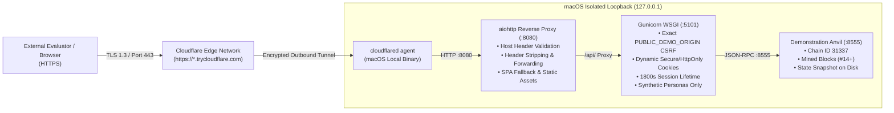

# EVIDENCECHAIN — CLOUDFLARE QUICK TUNNEL OPERATIONAL RUNBOOK
**Document Reference:** `EC-RUNBOOK-2026-CLOUDFLARE-TUNNEL-01`  
**Classification:** DEPLOYMENT PROCEDURE & OPERATIONAL RUNBOOK  
**Technology:** Cloudflare Quick Tunnel (`cloudflared`)  
**Target Ingress:** `http://127.0.0.1:8080` (Strictly Loopback-Only Reverse Proxy)  
**Hosting Cost:** $0.00 (Zero monetary expense, no credit card, no custom domain)  
**Status:** FULLY HARDENED & PERSISTENCE VERIFIED • STOPPED PENDING USER APPROVAL  

---

## 1. ARCHITECTURE & ZERO-COST TUNNEL OVERVIEW

Cloudflare Quick Tunnel establishes an outbound, encrypted TLS 1.3 tunnel between the public internet and the local macOS loopback port (`127.0.0.1:8080`).



### Critical Security Protections:
1. **Exact Origin Whitelisting:** The application **never accepts arbitrary `*.trycloudflare.com` origins**. When a tunnel starts, the exact assigned HTTPS URL is registered as `PUBLIC_DEMO_ORIGIN`. Unrelated TryCloudflare hostnames are blocked with `HTTP 400 Bad Request` at the reverse proxy and `HTTP 403 Forbidden` at the backend.
2. **Reverse Proxy Sanitization:** The reverse proxy strips all incoming `X-Forwarded-*` headers sent by external clients, preventing header-injection and IP/protocol spoofing.
3. **Loopback Isolation:** The Flask backend (`:5101`) and demonstration Anvil EVM (`:8555`) listen strictly on `127.0.0.1`. The tunnel daemon targets exclusively `http://127.0.0.1:8080`.
4. **Zero Impact on Baseline Infrastructure:** The protected development Anvil node (`:8545`) and baseline database (`backend/evidencechain.db`) remain 100% untouched and cannot be accessed over the tunnel.

---

## 2. PRE-REQUISITES & HEALTH VERIFICATION

Before starting the tunnel, confirm the local stack is healthy and persistent:

- [x] Dedicated Anvil EVM active on `127.0.0.1:8555` (State snapshot: `demo_data/.anvil_demo_state.json`)
- [x] Gunicorn WSGI backend active on `127.0.0.1:5101` (2 sync workers, fail-closed runtime interlocks)
- [x] aiohttp reverse proxy active on `127.0.0.1:8080` (Serving `frontend/dist/`)
- [x] Cold restart persistence test passed (`scripts/verify_persistence.py`: 100% PASS)
- [x] Security controls test passed (`scripts/verify_security_safeguards.py`: 12/12 PASS)
- [x] Smoke test suite passed (`scripts/run_smoke_tests.py`: 14/14 PASS)
- [x] Protected Anvil on port 8545 untouched (Block #113 verified)
- [x] Protected SQLite database untouched (27 original records, canonical manifest hash `148edd48...`)
- [ ] **EXPLICIT USER AUTHORIZATION GRANTED**

---

## 3. TUNNEL LAUNCH PROCEDURES

### 3.1 Automated Launch with Dynamic Origin Registration (Recommended)
This command spawns `cloudflared`, extracts the dynamically assigned URL, registers the exact origin into `.env.demo`, gracefully reloads Gunicorn workers, and restores loopback isolation upon teardown:

```bash
# Open Public Demonstration Mode:
cd ./EvidenceChain_Local_Demo
backend/venv/bin/python scripts/launch_public_tunnel.py
```

```bash
# Faculty-Restricted Access Mode (Cloudflare Access PIN required):
cd ./EvidenceChain_Local_Demo
backend/venv/bin/python scripts/launch_public_tunnel.py --allowed-mail evaluator@university.edu
```

### 3.2 Manual Two-Stage Launch & Quarantine Registration Procedure
If running `cloudflared` manually in a dedicated terminal window, enforce the mandatory two-stage launch quarantine:

```bash
# Step 1: Start tunnel targeting exclusively the same-origin reverse proxy on port 8080
cloudflared tunnel \
  --url http://127.0.0.1:8080
```

```bash
# Step 2 (Stage 1 — Quarantined): Register the exact assigned URL printed by cloudflared.
# In quarantine mode, external requests receive HTTP 503 while pre-flight security tests run locally.
cd ./EvidenceChain_Local_Demo
backend/venv/bin/python scripts/update_public_origin.py https://<assigned-subdomain>.trycloudflare.com
```

```bash
# Step 3: Verify local loopback health and confirm external tunnel requests receive HTTP 503 quarantine
curl -s http://127.0.0.1:8080/api/health
curl -s -H "Host: <assigned-subdomain>.trycloudflare.com" http://127.0.0.1:8080/api/health
# Expected: {"status": "quarantined", "message": "Demonstration gateway is initializing..."}
```

```bash
# Step 4 (Stage 2 — Promoted): Enable external public ingress only after pre-flight security checks pass:
cd ./EvidenceChain_Local_Demo
backend/venv/bin/python scripts/update_public_origin.py https://<assigned-subdomain>.trycloudflare.com --enable
```

```bash
# Step 5 (Teardown): Restore loopback-only isolation immediately upon closing tunnel:
cd ./EvidenceChain_Local_Demo
backend/venv/bin/python scripts/update_public_origin.py --clear
```

---

## 4. EVALUATOR DEMO CREDENTIALS

Evaluators access the system using the one-click demonstration login screen:

| Persona | Synthetic Email | Role | Department & Operational Capabilities |
|:---|:---|:---|:---|
| **Arjun Mehta** | `a.mehta@metro-forensics.gov.example` | Senior Forensic Officer | Cyber Threat Forensics: Evidence upload, on-chain EVM registration, SHA-256 verification |
| **Priya Nair** | `p.nair@metro-forensics.gov.example` | Lead Cyber Investigator | Major Crimes Investigation: Case evidence review, cryptographic verification, custody tracking |
| **Karan Rao** | `k.rao@metro-forensics.gov.example` | Digital Forensics Analyst | Digital Evidence Review Board: Integrity audits, hash calculations, cryptographic proof inspection |
| **Neha Verma** | `n.verma@metro-forensics.gov.example` | Special Legal Prosecutor | Cyber Prosecution Directorate: Judicial review of chain of custody, access history inspection |
| **Devraj Singh** | `d.singh@metro-forensics.gov.example` | Evidence Vault Custodian | Central Forensic Vault: Vault media inspection, custodian logs, verification |

*Note: Administrative Head of Department (Dr. Vikram Seth, `v.seth@metro-forensics.gov.example`) is strictly blocked from demonstration sign-in by design to prevent privilege escalation.*

---

## 5. POST-LAUNCH VERIFICATION CHECKLIST (PHASE 8)

Once the public tunnel is active, perform these tests from an external device or cellular connection:

1. **HTTPS Handshake:** Load `https://<assigned-subdomain>.trycloudflare.com`. Verify valid Cloudflare TLS certificate.
2. **Host Validation:** Verify that navigating directly via IP or an unassigned hostname returns `HTTP 400 Bad Request`.
3. **Banner Notice:** Confirm the top educational demonstration banner is displayed.
4. **Sign In:** Sign in as Arjun Mehta. Confirm `Set-Cookie` contains `Secure`, `HttpOnly`, and `SameSite=Lax`.
5. **Evidence Repository:** Confirm synthetic demonstration records load cleanly.
6. **On-Chain Registration:** Upload a sample file and register on-chain. Confirm real EVM transaction receipt and block increment on port 8555.
7. **Hash Verification:** Perform cryptographic verification. Confirm `AUTHENTIC` status.
8. **Protected Baseline Verification:** Run local verification on port 8545 to confirm block height remains frozen at #113.

---

## 6. INSTANT TEARDOWN & CLEANUP

To revoke public access immediately:

```bash
# If using launch_public_tunnel.py:
Press CTRL+C in the terminal running the launcher script.

# If running cloudflared directly:
killall cloudflared 2>/dev/null || true
cd ./EvidenceChain_Local_Demo
backend/venv/bin/python scripts/update_public_origin.py --clear

echo "[+] Tunnel killed and public origin cleared. System restored to loopback-only."
```
