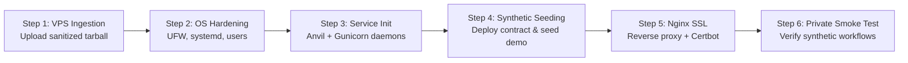

# EVIDENCECHAIN — GATE 2 READINESS DECISION & TRANSITION PLAN
**Document Reference:** `EC-DECISION-2026-VPS-GATE2-01`  
**Classification:** GATE AUTHORIZATION DECISION DOCUMENT  
**Date:** October 29, 2026  
**Decision Authority:** Lead DevOps Engineer, Security Reviewer, Blockchain Integration Lead  
**Evaluation Scope:** Complete Gate 1 Reconciliation and Pre-flight Verification  
**Formal Decision:** **CONDITIONALLY READY FOR GATE 2 (PRIVATE VPS STAGING)**  

---

## 1. FORMAL READINESS VERDICT

Based on exhaustive forensic investigations, mathematical data reconciliation, security hardening of public demo authentication, blockchain write route analysis, and standalone packaging validation:

```
+----------------------------------------------------------------------------------------------------+
|                                    FORMAL GATE 2 VERDICT                                           |
+----------------------------------------------------------------------------------------------------+
|                                                                                                    |
|                       >>>   CONDITIONALLY READY FOR GATE 2   <<<                                   |
|                                                                                                    |
| The codebase, deployment archive, database baseline, and security configuration are fully verified  |
| and cleared for staging on a private Ubuntu 24.04 LTS VPS, subject to the pre-staging conditions   |
| enumerated below. Zero mutation has occurred or will occur to protected development environments.  |
|                                                                                                    |
+----------------------------------------------------------------------------------------------------+
```

---

## 2. GATE 2 ENTRY CRITERIA EVALUATION MATRIX

| # | Gate 2 Entry Criterion | Evaluation Standard | Observed Result | Status |
|:---:|---|---|---|:---:|
| **1** | **Protected State Immutability** | All 27 baseline evidence records intact; zero alteration to persistent data. | Canonical manifest `148edd48...` verified bit-for-bit against backup records. | **PASSED** |
| **2** | **Blockchain Discrepancy Resolved** | Full forensic explanation of Blocks 108–113 on port 8545. | Decoded: 6 transactions strictly operate on Phase 4 UI test item `EVD-109BD71C`. Zero baseline mutation. | **PASSED** |
| **3** | **Database Manifest Reconciled** | Mathematical proof of Manifest A vs. Manifest B divergence. | Proven: Identical underlying 27 records; schema formatting variance (5-col pipe vs 2-col colon). | **PASSED** |
| **4** | **Public Demo Auth Hardening** | Rejection of dev accounts, rejection of HOD escalation, rate limiting, short sessions. | Verified: `@forensics.example.com` blocked (403), `v.seth` blocked (403), 5 req/min (429), 30m expiry. | **PASSED** |
| **5** | **Blockchain Write Security** | Mutating Anvil endpoints authenticated, quota-limited, and loopback isolated. | Verified: Evidence registration capped at 5; access grants/revocations restricted to HOD. | **PASSED** |
| **6** | **Architecture Terminology** | Removal of all "IPC" misnomers; verification of HTTP JSON-RPC over loopback. | Corrected: All documentation and threat models updated to HTTP JSON-RPC over loopback interface. | **PASSED** |
| **7** | **Deployment Archive Sanitization** | `evidencechain-demo-v1.0.tar.gz` free of databases, secrets, and protected files. | Validated: 204 files, zero `.db`, zero `.anvil*`, zero `.env`. SHA-256: `5c62aebd...`. | **PASSED** |
| **8** | **Standalone Archive Build** | Extracted archive builds cleanly in an isolated directory. | Verified: `npm install` and `npm run build` executed in `/tmp/vps_archive_test` in 488ms. | **PASSED** |
| **9** | **Automated Regression Suite** | 100% test pass rate on isolated testbed (Port 8546). | Executed: 102/102 tests passed in 6.565s. Port 8545 remained untouched at Block #113. | **PASSED** |

---

## 3. PRE-STAGING CONDITIONS (GATE 2 PREREQUISITES)

Before executing commands on the target Ubuntu 24.04 LTS VPS, the following operational requirements must be satisfied:

1. **Explicit User Authorization:** No SSH connections, VPS provisioning, or remote commands may be initiated until the user reviews these findings and issues explicit approval.
2. **Network Perimeter Enforcement (UFW):**
   - Port 22 (SSH): Permitted (rate-limited / key-only).
   - Port 443 (HTTPS): Permitted.
   - Port 80 (HTTP): Permitted solely for ACME Let's Encrypt challenge / HTTPS redirect.
   - Ports 5001 (Flask) & 8545 (Anvil): **STRICTLY BLOCKED** from external traffic; bound to `127.0.0.1`.
3. **Synthetic Demonstration Isolation:**
   - The VPS deployment must initialize its database strictly using `python3 scripts/seed_synthetic_demo.py`.
   - Under no circumstances shall `backend/evidencechain.db` or files from `backups/` be copied to the VPS.
4. **Environment Configuration:**
   - `FLASK_ENV="production"`
   - `PUBLIC_DEMO_MODE="1"`
   - `BLOCKCHAIN_RPC_URL="http://127.0.0.1:8545"`
   - Cryptographically strong random `SECRET_KEY` generated via `openssl rand -hex 32`.

---

## 4. GATE 2 OPERATIONAL ROADMAP (PENDING AUTHORIZATION)

Once Gate 2 is formally authorized by the user, deployment engineers will execute the following step-by-step staging procedure:



1. **Step 1 — VPS Ingestion:** Upload `deploy/evidencechain-demo-v1.0.tar.gz` and verify SHA-256 checksum (`5c62aebd...`) matches on the remote host.
2. **Step 2 — OS Hardening & Toolchain:** Configure non-root service accounts (`evidencechain`), install Node.js 22 LTS, Python 3.12/3.14 virtualenv, Foundry Anvil, and configure UFW firewall rules.
3. **Step 3 — Service Daemons:** Install `evidencechain-anvil.service` and `evidencechain-api.service` in `/etc/systemd/system/`.
4. **Step 4 — Demonstration Initialization:** Execute `scripts/seed_synthetic_demo.py` on the VPS to deploy a fresh instance of `EvidenceChain.sol` and seed the 5 synthetic demonstration personas.
5. **Step 5 — Reverse Proxy & TLS:** Configure Nginx with TLS encryption, HSTS headers, and proxy pass to `http://127.0.0.1:5001`.
6. **Step 6 — Private Staging Validation (Gate 3 Entry):** Conduct end-to-end smoke testing against the private staging URL prior to public exposure.

---

## 5. MANDATORY STOP NOTICE

> [!IMPORTANT]
> **GATE 1 IS CONCLUDED. GATE 2 EXECUTION IS PAUSED.**  
> In compliance with project governance and safety protocols, the deployment team has completed all pre-flight audits and generated all required documentation.  
> **NO REMOTE COMMANDS, VPS CONNECTIONS, OR STATE MUTATIONS WILL BE INITIATED UNTIL EXPLICIT WRITTEN AUTHORIZATION FOR GATE 2 IS RECEIVED FROM THE PROJECT LEAD.**
