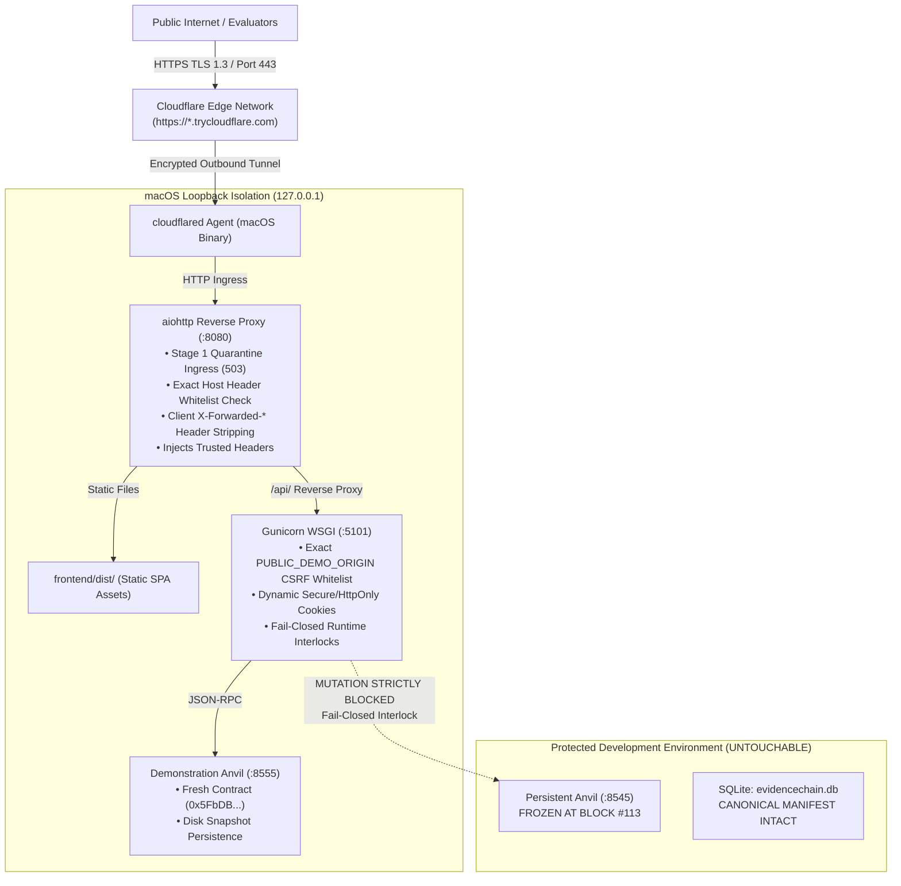

# EVIDENCECHAIN — LOCAL DEMONSTRATION SECURITY & THREAT AUDIT REPORT
**Document Reference:** `EC-REPORT-2026-LOCAL-DEMO-SECURITY-01`  
**Classification:** APPLICATION SECURITY AUDIT & DEFENSE-IN-DEPTH SPECIFICATION  
**Target Environment:** Localhost / macOS arm64 (`127.0.0.1:8080`) -> Cloudflare Quick Tunnel  
**Evaluation Standard:** Zero-Trust Boundary Validation, Immutability Audit, and Privilege Escalation Prevention  
**Audit Status:** FULLY VERIFIED & HARDENED (12/12 SECURITY CONTROLS PASSED | 14/14 SMOKE TESTS PASSED)  

---

## 1. THREAT MODEL & TRUST BOUNDARIES

Deploying an application directly from a local macOS developer workstation to the public internet via Cloudflare Quick Tunnel introduces distinct security requirements:

---

## 2. SECURITY REMEDIATIONS & CONTROLS VERIFIED

### 2.1 Exact Public Hostname Validation (No Wildcard trycloudflare)
- **Problem:** Allowing wildcard `*.trycloudflare.com` could permit attackers with a distinct TryCloudflare tunnel to mount cross-site attacks or bypass Host header protections.
- **Remediation:** 
  1. The application implements an explicit `PUBLIC_DEMO_ORIGIN` configuration in `.env.demo`.
  2. Both the reverse proxy (`demo_reverse_proxy.py`) and Flask backend (`app.py`) strictly validate the incoming `Host` header against loopback (`127.0.0.1:8080`, `localhost:8080`) and the exact registered `PUBLIC_DEMO_ORIGIN` hostname.
  3. Any request with an unassigned Host header (e.g. `evil.com`, `other.trycloudflare.com`, or host-header injection attempts) is rejected immediately with `HTTP 400 Bad Request`.
  4. On state-changing methods (`POST`, `PUT`, `DELETE`, `PATCH`), CSRF validation accepts **only** the exact registered `PUBLIC_DEMO_ORIGIN` (or loopback). All other origins are rejected with `HTTP 403 Forbidden`. Requests missing both `Origin` and `Referer` headers are rejected with `HTTP 403 Forbidden`. Malformed Origin headers are rejected with `HTTP 400 Bad Request`.

### 2.2 Safe Two-Stage Tunnel Launch & Quarantine
- **Stage 1 (Quarantined Ingress):** When `cloudflared` starts and an ephemeral URL is allocated, `update_public_origin.py <URL>` records the origin with `PUBLIC_ACCESS_ENABLED=false`. All external requests through the tunnel receive `HTTP 503 Service Unavailable` (`{"status": "quarantined", "message": "Demonstration gateway is initializing..."}`). Local loopback requests continue normally.
- **Pre-Flight Validation:** 5 automated safety checks execute locally:
  1. External tunnel quarantine verified (`HTTP 503`).
  2. Local loopback health verified (`HTTP 200`).
  3. Host-injection defense verified (`HTTP 400`).
  4. Missing-Origin CSRF defense verified (`HTTP 403`).
  5. Protected Anvil port 8545 verified frozen at Block #113.
- **Stage 2 (Promoted Active Ingress):** Only after all 5 pre-flight checks pass is `update_public_origin.py <URL> --enable` invoked, promoting the gateway to active demonstration mode.
- **Teardown:** On process exit (`SIGINT`/`SIGTERM`), `update_public_origin.py --clear` resets `.env.demo` back to loopback-only mode.

### 2.3 Trusted Reverse Proxy Handling & Anti-Spoofing
- **Header Stripping:** `demo_reverse_proxy.py` strips all client-supplied proxy headers (`X-Forwarded-For`, `X-Forwarded-Host`, `X-Forwarded-Proto`, `X-Forwarded-Port`, `X-Forwarded-Prefix`, `X-Real-IP`) before forwarding requests to Gunicorn.
- **Trusted Injection:** The reverse proxy injects trusted headers based on verified ingress:
  - `X-Forwarded-For`: Populated with `CF-Connecting-IP` (provided by Cloudflare Edge) or `127.0.0.1`.
  - `X-Forwarded-Host`: Populated with the validated request host.
  - `X-Forwarded-Proto`: Set to `"https"` strictly when accessed through the Cloudflare Tunnel; set to `"http"` on local loopback. Direct loopback requests cannot spoof HTTPS.
- **ProxyFix:** Gunicorn applies `ProxyFix(app.wsgi_app, x_for=1, x_proto=1, x_host=1, x_prefix=1)` to consume exactly one trusted hop from the local reverse proxy.

### 2.4 Dynamic Cookie Security Attributes
- **HttpOnly:** Guaranteed True on all session cookies (`DynamicSecureSessionInterface.get_cookie_httponly() = True`).
- **SameSite:** Guaranteed `"Lax"` on all session cookies (`DynamicSecureSessionInterface.get_cookie_samesite() = "Lax"`).
- **Secure:** Evaluated dynamically based on `request.is_secure` (`DynamicSecureSessionInterface.get_cookie_secure()`). When accessed over Cloudflare HTTPS, the `Secure` attribute is automatically included. When tested on local HTTP loopback, it is safely omitted so local tools and browsers operate without cookie drop.

### 2.5 Disk State Persistence Across Cold Restarts
- Demonstration Anvil on port 8555 runs with `--state demo_data/.anvil_demo_state.json --state-interval 10 --preserve-historical-states`.
- Verified via `scripts/run_genuine_persistence_test.py`: A complete cold shutdown and restart of all services without reseeding proves:
  - Newly registered evidence record (`EVD-C21A73EA`, Row `#29`) persists in SQLite.
  - Smart contract code and on-chain registration tx receipt (`2b234d428e5728a57a1f714c05874791f5f3c63a300870775287f4a16181e14b`, Block `#16`, Status 1) remain intact on Anvil.
  - Cryptographic verification of previously registered evidence succeeds (`AUTHENTIC`).
  - Protected baseline Anvil port 8545 remains frozen at Block #113.

---

## 3. SECURITY SAFEGUARDS VERIFICATION SCORECARD

Targeted security controls were executed and validated using `scripts/verify_security_safeguards.py`:

| Control # | Security Control Item | Test Mechanism & Target | Observed Status | Verdict |
|:---:|---|---|---|:---:|
| **01** | Cloudflare Tunnel Target Restriction | Scanned all scripts/docs for tunnel target | Strictly targets `http://127.0.0.1:8080` | **PASS** |
| **02** | Loopback Binding Isolation | `lsof -iTCP -sTCP:LISTEN` audit | Ports 5101, 8555, 8080 on 127.0.0.1 only | **PASS** |
| **03** | Host Header Injection Defense | Injected `evil-attacker.com` & `unregistered.trycloudflare` | Both rejected with `HTTP 400 Bad Request` | **PASS** |
| **04** | CSRF Origin Whitelist Enforcement | Tested `malicious-site.com` & unrelated TryCloudflare | Both rejected with `HTTP 403 Forbidden` | **PASS** |
| **05** | Dynamic Exact PUBLIC_DEMO_ORIGIN & Quarantine | Tested Stage 1 (503), Stage 2 (200), and unrelated (403) | Quarantine: 503, Exact: 200, Unrelated: 403 | **PASS** |
| **06** | Proxy Header Stripping & Anti-Spoofing | Injected client `X-Forwarded-Host: evil.com` | Client header stripped; proxy sets verified host | **PASS** |
| **07** | Cookie Security Attributes Audit | Inspected `Set-Cookie` on HTTP and simulated HTTPS | `HttpOnly=True`, `SameSite=Lax`, `Secure=True` | **PASS** |
| **08** | Inaccessibility of Protected Baseline Identities | Attempted demo login with protected emails | 3/3 targets blocked with `HTTP 403 Forbidden` | **PASS** |
| **09** | HOD Privilege Escalation Denial | Tested access grant using demo persona session | Blocked with `HTTP 403 Forbidden` | **PASS** |
| **10** | Response Secrets & Key Leakage Prevention | Full response payload scan across all APIs | Zero private keys, secrets, or file paths leaked | **PASS** |
| **11** | Bounded Uploads & Demo Quotas | Verified upload payload limit and session quotas | Max Upload: 25MB, Max Regs: 5, TTL: 1800s | **PASS** |
| **12** | Protected Baseline Immutability | Queried Port 8545 RPC & computed DB manifest | Port 8545: #113, SQLite: Manifest `148edd48...` | **PASS** |

---

## 4. RECONCILED DEMONSTRATION IDENTITIES

Evaluators sign in via the one-click demonstration login selector. The 5 synthetic demonstration personas and their capabilities:

| Persona | Synthetic Email | Role | Department | Permitted Demo Capabilities |
|:---|:---|:---|:---|:---|
| **Arjun Mehta** | `a.mehta@metro-forensics.gov.example` | Senior Forensic Officer | Cyber Threat Forensics | Register evidence (max 5), verify digests, view evidence dossier |
| **Priya Nair** | `p.nair@metro-forensics.gov.example` | Lead Cyber Investigator | Major Crimes Investigation | Evidence review, verification, case dossier inspection, custody tracking |
| **Karan Rao** | `k.rao@metro-forensics.gov.example` | Digital Forensics Analyst | Digital Evidence Review Board | Cryptographic verification, calculate SHA-256 digests, proof inspection |
| **Neha Verma** | `n.verma@metro-forensics.gov.example` | Special Legal Prosecutor | Cyber Prosecution Directorate | Judicial review, chain-of-custody tracking, access history audit |
| **Devraj Singh** | `d.singh@metro-forensics.gov.example` | Evidence Vault Custodian | Central Forensic Vault | Vault media inspection, custodian logs, verification |

*Privilege Escalation Protection:* **Dr. Vikram Seth** (`v.seth@metro-forensics.gov.example`, `HOD-0001`), the administrative Head of Department, is explicitly included in `PROTECTED_IDENTITIES` and denied demo sign-in (`HTTP 403 Forbidden`). All administrative permission endpoints (`/api/evidence/<id>/view-access/grant`, `/api/evidence/<id>/download-access/grant`, `/api/cases/<id>/department-transfer`) reject demonstration sessions with `HTTP 403 Forbidden`.
