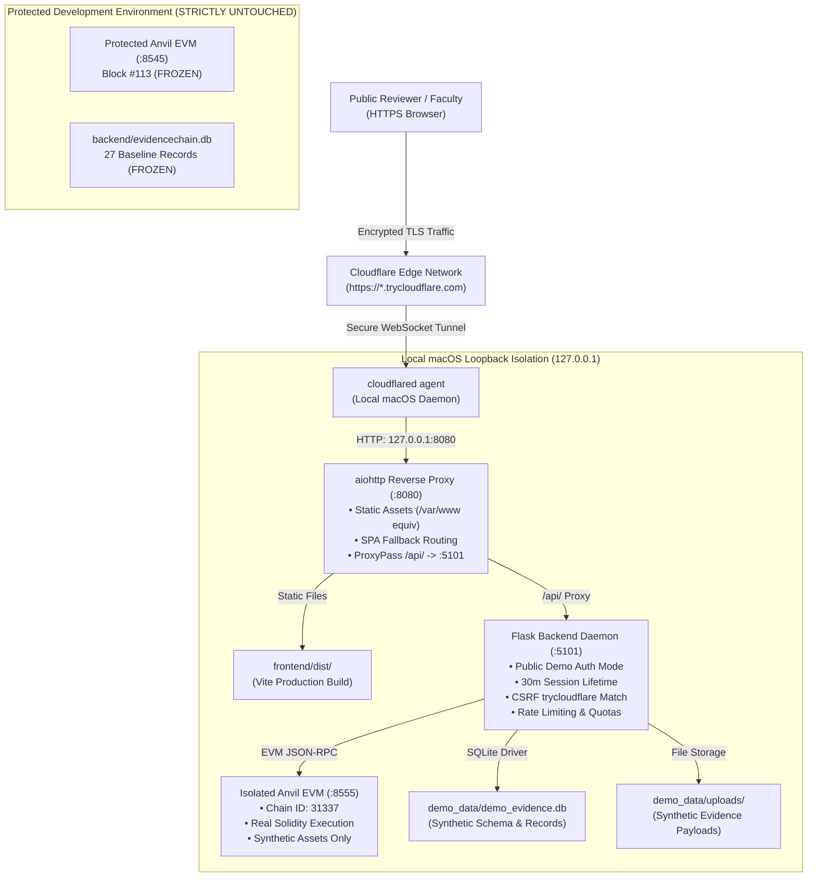

# EVIDENCECHAIN — ZERO-COST LOCAL DEMO SETUP GUIDE
**Document Reference:** `EC-GUIDE-2026-LOCAL-DEMO-SETUP-01`  
**Classification:** LOCAL DEPLOYMENT & ZERO-COST STAGING RUNBOOK  
**Target Environment:** macOS (Apple Silicon arm64)  
**Host Architecture:** Local Same-Origin Reverse Proxy (`127.0.0.1:8080`) + Cloudflare Quick Tunnel  
**Zero Monetary Cost:** $0.00 (No VPS, No Paid Domain, No Credit Card, No Cloud RPC)  
**Smart Contract Execution:** Genuine Local EVM Blockchain (Foundry Anvil on Port 8555)  
**Integrity Protection:** 100% Isolated from Protected Development State (Port 8545 & Baseline SQLite)  

---

## 1. ARCHITECTURE & COMPONENT OVERVIEW

The EvidenceChain zero-cost demonstration environment operates entirely on the local Mac host, utilizing free Cloudflare Quick Tunnels to present a production-grade, HTTPS-accessible Digital Evidence Management & Chain of Custody interface to faculty, evaluators, or public reviewers.



---

## 2. PORT & RUNTIME ALLOCATION MATRIX

| Component | Network Address | Function / Isolation Status |
|---|---|---|
| **Cloudflare Quick Tunnel** | `https://*.trycloudflare.com` | Public HTTPS ingress; terminates TLS; tunnels to local port 8080. |
| **Local Reverse Proxy** | `http://127.0.0.1:8080` | Production HTTP server; serves `frontend/dist` & proxies `/api/` to 5101. |
| **Demonstration Flask API** | `http://127.0.0.1:5101` | Application backend; authenticates demo personas; signs demo EVM transactions. |
| **Demonstration Anvil Node** | `http://127.0.0.1:8555` | Dedicated EVM node; mines genuine blocks for demo evidence and permissions. |
| **Protected Anvil Node** | `http://127.0.0.1:8545` | **PROTECTED DEVELOPMENT NODE (Block #113)** — Strictly shielded by fail-closed interlocks. |
| **Isolated Test Anvil Node** | `http://127.0.0.1:8546` | **TEST AUTOMATION NODE** — Reserved for unit and regression test suites. |

---

## 3. DIRECTORY STRUCTURE

The demonstration runtime is self-contained in `./EvidenceChain_Local_Demo`:

```
./EvidenceChain_Local_Demo/
├── .env.demo                          # Dedicated demonstration environment variables
├── bin/
│   └── cloudflared                    # Standalone Cloudflare tunnel agent (version 2026.10.7)
├── demo_data/
│   ├── .anvil_demo_state.json         # Anvil EVM snapshot for demonstration persistence
│   ├── demo_evidence.db               # Isolated SQLite database with synthetic records
│   └── uploads/                       # Synthetic evidence file vault
├── backend/
│   ├── app.py                         # Flask application with ProxyFix & dynamic secure cookies
│   ├── auth.py                        # Demo authentication & persona resolution
│   ├── blockchain.py                  # Web3 contract integration with port-8545 fail-closed interlocks
│   ├── database/                      # Schema definition and SQLite helpers
│   └── venv/                          # Dedicated virtualenv (Python 3.14, Flask, Web3, aiohttp)
├── frontend/
│   ├── dist/                          # Production Vite bundle (same-origin relative API routing)
│   ├── src/                           # Living Dossier UI with persistent demonstration banner
│   └── package.json                   # UI build dependencies
├── contracts/
│   └── EvidenceChain.sol              # Smart contract source
├── artifacts/
│   └── contracts/EvidenceChain.sol/
│       └── EvidenceChain.json         # Compiled contract ABI & bytecode
└── scripts/
    ├── demo_reverse_proxy.py          # Production aiohttp reverse proxy daemon
    ├── seed_synthetic_demo.py         # Automated contract deployment and demo data seeder
    └── run_smoke_tests.py             # 14-point pre-flight validation suite
```

---

## 4. RAPID STARTUP RUNBOOK

### Command 1: Start Demonstration Anvil Node (Port 8555)
```bash
cd ./EvidenceChain_Local_Demo
~/.foundry/bin/anvil --port 8555 --chain-id 31337 \
  --state demo_data/.anvil_demo_state.json \
  --preserve-historical-states > /dev/null 2>&1 &
```

### Command 2: Seed Demonstration Database & Deploy Contract (First Run Only)
```bash
cd ./EvidenceChain_Local_Demo
backend/venv/bin/python -c "
from scripts.seed_synthetic_demo import seed
seed(
    database_path='demo_data/demo_evidence.db',
    upload_folder='demo_data/uploads',
    rpc_url='http://127.0.0.1:8555'
)
"
```

### Command 3: Start Demonstration Flask Backend (Port 5101)
```bash
cd ./EvidenceChain_Local_Demo/backend
venv/bin/python app.py > /dev/null 2>&1 &
```

### Command 4: Start Same-Origin Reverse Proxy (Port 8080)
```bash
cd ./EvidenceChain_Local_Demo
backend/venv/bin/python scripts/demo_reverse_proxy.py > /dev/null 2>&1 &
```

### Command 5: Run Pre-Flight Smoke Test Suite
```bash
cd ./EvidenceChain_Local_Demo
backend/venv/bin/python scripts/run_smoke_tests.py
```
*Expected Result: `SMOKE TEST SCORECARD: 14/14 TESTS PASSED`*

---

## 5. SHUTDOWN RUNBOOK

To terminate all demonstration services cleanly without affecting protected background daemons:
```bash
# Kill reverse proxy on 8080
kill $(lsof -t -i :8080) 2>/dev/null || true

# Kill demo backend on 5101
kill $(lsof -t -i :5101) 2>/dev/null || true

# Kill demo anvil on 8555
kill $(lsof -t -i :8555) 2>/dev/null || true

# Kill cloudflared tunnel
killall cloudflared 2>/dev/null || true
```
*(Protected Anvil on port 8545 and Isolated Test Anvil on port 8546 remain untouched and running.)*
