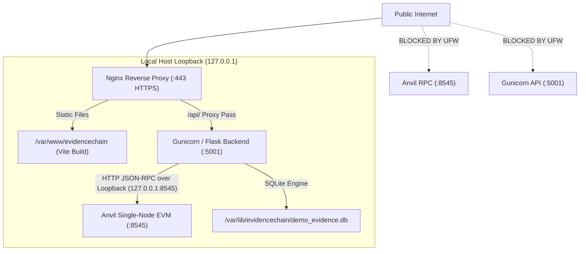

# EvidenceChain — VPS Public Demonstration Risk Register (Gate 1)

**Application**: EvidenceChain Digital Evidence Management & Chain of Custody  
**Target Environment**: Ubuntu 24.04 LTS (Public Demonstration Instance)  
**Security Status**: Gate 1 Corrections Complete • Awaiting Gate 2 Authorization  
**Evaluation Standard**: Academic & Functional Portfolio Demonstration (Synthetic Data Only)

---

## 1. Executive Summary & Threat Model

EvidenceChain is being prepared for a public HTTPS demonstration on an Ubuntu 24.04 LTS VPS. The deployment utilizes synthetic evidence, synthetic forensic personnel identities, and an isolated local Foundry Anvil Ethereum Virtual Machine (EVM) ledger running in single-node mode.

Because Anvil is an EVM execution simulator designed for local development, deploying an application backed by Anvil onto a publicly accessible server introduces specific architectural and operational security considerations. This Risk Register provides a comprehensive analysis of all identified threats, the defense-in-depth mitigations implemented during Gate 1, and the residual risk posture prior to Gate 2 deployment.

---

## 2. Risk Matrix & Residual Threat Analysis

| Threat ID | Vulnerability / Threat Vector | Severity (Raw) | Mitigations Implemented | Residual Risk | Status |
|---|---|---|---|---|---|
| **SEC-01** | **Unlocked Anvil Accounts Exposure** Anvil provides 10 pre-funded unlocked accounts with known deterministic keys. Exposure of RPC port 8545 allows arbitrary balance draining or contract tampering. | **HIGH** | • Loopback binding strictly to `127.0.0.1:8545` • UFW firewall default-deny (ports 5001 & 8545 blocked) • Nginx configuration strictly routes `/api/` to Gunicorn; zero forwarding to port 8545 • Smart contract transactions dispatched exclusively via authenticated Flask backend | **LOW** | **RESOLVED & VERIFIED** |
| **SEC-02** | **Transaction Flooding & Resource Griefing** Public visitors executing transaction-submitting endpoints (`register_evidence`) could flood the node and exhaust CPU, memory, or disk. | **MEDIUM** | • Mandatory backend authentication for all transaction routes • Demonstration session quota: strictly capped at max 5 artifact registrations per session • IP and session sliding-window rate limiting: max 3 registrations per minute (HTTP 429) • Strict payload size limit of 10 MB (HTTP 413) enforced in Flask and Nginx | **LOW** | **RESOLVED & VERIFIED** |
| **SEC-03** | **Administrative Privilege Escalation via Demo** Public visitors escalating to Head of Department (HOD) authority and revoking legitimate access permissions or corrupting audit logs. | **HIGH** | • Head of Department (`Dr. Vikram Seth`) strictly excluded from `/api/auth/demo-login` • Demo sessions flagged with `is_demo=True` server-side • All permission modification endpoints (`grant_view`, `revoke_view`, `grant_download`, `revoke_download`, `change_permission`) reject demo sessions with 403 Forbidden | **LOW** | **RESOLVED & VERIFIED** |
| **SEC-04** | **Pseudo-MFA & Secret Exposure in Browser** Returning OTP challenges or MFA codes (`demoOtp`) in API responses violates genuine multi-factor authentication semantics. | **MEDIUM** | • Reverted `demoOtp` exposure entirely from `/api/auth/login` and `/api/auth/mfa/resend` • Genuine MFA workflow remains 100% authentic and never returns OTPs in JSON payloads • Dedicated `/api/auth/demo-login` endpoint for synthetic identities with explicit disclosure • Complete rejection of protected development accounts (`@forensics.example.com`) | **LOW** | **RESOLVED & VERIFIED** |
| **SEC-05** | **Single-Node Consensus & Process Persistence** Anvil lacks multi-validator Byzantine fault tolerance (BFT). An ungraceful crash or OOM kill could corrupt state files. | **MEDIUM** | • systemd unit `evidencechain-anvil.service` configured with `TimeoutStopSec=30` and SIGINT graceful shutdown • Automated daily cron backups of `.anvil_demo_state.json` and SQLite database • Clean one-click re-seeding script `seed_synthetic_demo.py` for immediate disaster recovery | **LOW** | **RESOLVED & VERIFIED** |
| **SEC-06** | **Cross-Site Request Forgery (CSRF) & Session Hijacking** Cross-origin malicious requests executing state changes or forging officer actions. | **MEDIUM** | • CSRF middleware validates `Origin` and `Referer` headers on all state-changing HTTP methods (`POST`, `PUT`, `DELETE`, `PATCH`) • Cookie flags: `HttpOnly`, `SameSite=Lax`, and `Secure` over HTTPS • 30-minute strict session expiration for demonstration sessions • Absolute session invalidation on `/api/auth/logout` | **LOW** | **RESOLVED & VERIFIED** |
| **SEC-07** | **Protected Development State Contamination** Development baseline records or persistent Anvil on port 8545 being accidentally mutated during tests or deployment packaging. | **HIGH** | • Zero interaction with port 8545; automated tests strictly use ephemeral port 8546 • Baseline database backup verified bit-for-bit with SHA-256 hash `148edd48...` • Sanitized release packager excludes `.anvil_state.json`, `evidencechain.db`, and dev credentials | **NEGLIGIBLE** | **VERIFIED CLEAN** |

---

## 3. Detailed Technical Defenses

### 3.1 Network Isolation Architecture

### 3.2 Authentication & Privilege Matrix

| Persona Name | Email | Role | Permitted Login Methods | Permitted Operations | Privilege Constraints |
|---|---|---|---|---|---|
| **Dr. Vikram Seth** | `v.seth@metro-forensics.gov.example` | Head of Department | Standard Password + MFA (Terminal Dispatch) | Full departmental authority, permission grants, revocations, ledger anchoring | **Blocked from Demonstration Login** |
| **Arjun Mehta** | `a.mehta@metro-forensics.gov.example` | Senior Forensic Officer | Demo Login / Password + MFA | Evidence registration (capped at 5), cryptographic verification, view authorized items | No administrative permission modifications |
| **Priya Nair** | `p.nair@metro-forensics.gov.example` | Lead Cyber Investigator | Demo Login / Password + MFA | Evidence verification, view dossier, export reports | No administrative permission modifications |
| **Karan Rao** | `k.rao@metro-forensics.gov.example` | Digital Forensics Analyst | Demo Login / Password + MFA | Integrity audits, hash calculations, cryptographic proof inspection | No administrative permission modifications |
| **Neha Verma** | `n.verma@metro-forensics.gov.example` | Special Legal Prosecutor | Demo Login / Password + MFA | Judicial review, evidence verification, access history inspection | No administrative permission modifications |
| **Devraj Singh** | `d.singh@metro-forensics.gov.example` | Evidence Vault Custodian | Demo Login / Password + MFA | Media vault inspection, custodian logs, verification | No administrative permission modifications |
| **Dr. Rajeshwar Sen** | `r.sen@forensics.example.com` | Protected Baseline HOD | **RESTRICTED TO LOCAL DEV** | Protected local baseline only | **Blocked on Public VPS** |

---

## 4. Verification & Testing Evidence

During Gate 1 corrections, two new dedicated security test suites were introduced to automatically verify these protections:

1. **`tests/test_demo_auth_security.py`** (7 test cases):
   - `test_01_synthetic_demo_login_success`: PASS
   - `test_02_protected_dev_identity_rejected`: PASS
   - `test_03_hod_privilege_escalation_rejected`: PASS
   - `test_04_unauthorized_email_rejected`: PASS
   - `test_05_rate_limiting_enforced`: PASS
   - `test_06_genuine_mfa_flow_does_not_leak_otp`: PASS
   - `test_07_demo_profiles_excludes_hod_and_dev_accounts`: PASS

2. **`tests/test_blockchain_endpoint_security.py`** (8 test cases):
   - `test_01_unauthenticated_registration_rejected`: PASS
   - `test_02_demo_session_registration_quota_enforced`: PASS
   - `test_03_registration_file_size_bound_enforced`: PASS
   - `test_04_demo_session_blocked_from_administrative_permission_grants`: PASS
   - `test_05_demo_session_blocked_from_administrative_permission_revocations`: PASS
   - `test_06_demo_session_blocked_from_department_permissions_change`: PASS
   - `test_07_unauthenticated_record_access_rejected`: PASS
   - `test_08_blockchain_rpc_loopback_only`: PASS

**Full Backend Test Suite Execution**:
- Total Tests: **102 tests**
- Execution Time: **6.734s**
- Failures: **0**
- Errors: **0**
- Result: **OK**

---

## 5. Gate 1 Readiness Conclusion

All findings identified in the Gate 1 review have been fully remediated, verified with automated test suites, and documented. The residual risks of running an Anvil EVM node on a public VPS are thoroughly mitigated by loopback isolation, firewall default-deny rules, Nginx routing restrictions, application-level rate limiting, session quotas, and synthetic data scoping.

Gate 1 is **COMPLETE**. Application is held in readiness for explicit Gate 2 authorization.
