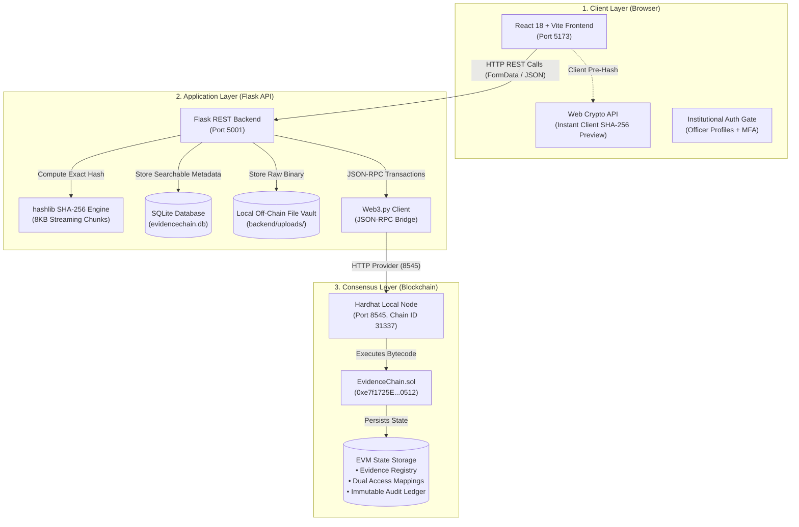

# EvidenceChain Complete System Architecture & Operational Manual

> **Document Version:** 2.0 (Editorial Forensic Architecture Edition)  
> **Repository Location:** `~/Desktop/EvidenceChain`  
> **Tech Stack:** React 18, Vite, Python Flask, Web3.py, SQLite, Solidity 0.8.20, Hardhat Local EVM

---

## 1. Executive Summary & Core Forensic Philosophy

### The Digital Evidence Integrity Crisis
In modern criminal jurisprudence and corporate litigation, evidence (surveillance video, digital phone extractions, email archives, hard disk images) is stored on centralized cloud storage servers or conventional relational databases. This introduces critical vulnerabilities:
1. **Administrator Tampering:** Anyone with root privileges on the server or database can alter file contents, manipulate creation timestamps, or delete custody logs without leaving a trace.
2. **Repudiation:** Investigators or forensic examiners can deny accessing, leaking, or modifying evidence.
3. **Loss of Verifiable Authenticity:** In court, if a defense counsel asserts that a video file was compressed, edited, or deepfaked between police seizure and trial, conventional databases cannot provide mathematical proof of integrity.

### The EvidenceChain Solution
EvidenceChain guarantees **mathematical, non-repudiable integrity** through a hybrid architecture:
- **Off-Chain Storage:** Heavy physical files stay in a local, secure disk vault (`backend/uploads/`), avoiding blockchain storage fees and gas limits.
- **On-Chain Cryptographic Anchoring:** A **SHA-256 cryptographic fingerprint** is calculated from the raw file bytes and anchored into an immutable Ethereum smart contract along with the Case Docket ID, registering officer address, and block timestamp.
- **Smart Contract Dual-Permission Matrix:** Access is split into **VIEW** (visual inspection) and **DOWNLOAD** (physical file extraction) rights, enforced directly on the blockchain.
- **Non-Repudiable Audit Logging:** Every preview or download automatically executes an on-chain transaction that logs the officer's wallet address, action, and block timestamp permanently.

---

## 2. High-Level Architecture Topology



---

## 3. The Tri-Tier Storage Architecture

| Dimension | Tier 1: Off-Chain File Vault | Tier 2: Relational SQLite DB | Tier 3: Blockchain State |
| :--- | :--- | :--- | :--- |
| **Physical Location** | `backend/uploads/` directory | `backend/evidencechain.db` | EVM contract storage (`0xe7f1...`) |
| **Data Kept** | Raw binary files (`.mp4`, `.pdf`, `.png`, `.txt`) | Evidence ID, Case ID, Title, Description, File Path, Foreign Keys | Evidence ID, Case ID, SHA-256 Hash string, Owner address, Timestamp, Permissions, Audit logs |
| **Why Here?** | Storing megabytes on-chain costs thousands in gas and exceeds block limits. | Allows rapid full-text search, filtering, and UI pagination. | Provides tamper-evidence, non-repudiation, and decentralized access rules. |
| **Mutability** | Mutable at the OS level (tampering is immediately exposed by verification). | Mutable by application server. | **Strictly Immutable:** once written to a block, it can never be edited or deleted. |

---

## 4. Smart Contract Deep Dive (`EvidenceChain.sol`)

Compiled with Solidity ^0.8.20 and deployed on the local Hardhat network at address `0xe7f1725E7734CE288F8367e1Bb143E90bb3F0512`.

### Structs & State Variables
```solidity
struct Evidence {
    string evidenceId;       // Unique ID, e.g. "EVD-DFE7F414"
    string caseId;           // Case Docket, e.g. "CASE-REFINEMENT-001"
    string evidenceHash;     // 64-character SHA-256 hex string
    address registeredBy;    // Ethereum wallet of the seizing officer
    uint256 timestamp;       // Block timestamp (Unix epoch seconds)
}

struct AccessRecord {
    address accessedBy;      // Officer who triggered the action
    string action;           // "VIEW" or "DOWNLOAD"
    uint256 timestamp;       // Block timestamp
}

mapping(string => Evidence) public evidences;
mapping(string => AccessRecord[]) public accessHistory;
mapping(string => mapping(address => bool)) public viewAccess;
mapping(string => mapping(address => bool)) public downloadAccess;
```

### Key Functions
- `registerEvidence(string _evidenceId, string _caseId, string _evidenceHash)`: Checks that the evidence does not exist; creates the record; automatically assigns both `viewAccess` and `downloadAccess` to `msg.sender`; emits `EvidenceRegistered`.
- `getEvidence(string _evidenceId)`: Returns the `Evidence` tuple.
- `verifyEvidence(string _evidenceId, string _currentHash)`: Returns boolean matching `keccak256(storedHash) == keccak256(currentHash)`.
- `grantViewAccess(string _evidenceId, address _user)`: `onlyEvidenceOwner` modifier; sets `viewAccess = true`.
- `revokeViewAccess(string _evidenceId, address _user)`: `onlyEvidenceOwner`; sets `viewAccess = false`.
- `grantDownloadAccess(string _evidenceId, address _user)`: `onlyEvidenceOwner`; sets `downloadAccess = true`.
- `revokeDownloadAccess(string _evidenceId, address _user)`: `onlyEvidenceOwner`; sets `downloadAccess = false`.
- `canView(string _evidenceId, address _user)`: View function checking `viewAccess[_evidenceId][_user]`.
- `canDownload(string _evidenceId, address _user)`: View function checking `downloadAccess[_evidenceId][_user]`.
- `recordAccess(string _evidenceId, string _action)`: Validates that the caller holds active permission for that action, appends `AccessRecord` to `accessHistory`, and emits `EvidenceAccessed`.
- `getAccessHistory(string _evidenceId)`: Returns the array of access events.

---

## 5. Minute Step-by-Step Workflows

### 5.1 Evidence Registration & Blockchain Anchoring
1. **Intake Form:** The officer enters the Case ID (e.g. `CASE-2026-001`), an optional description, and drags/drops an evidence file.
2. **Client-Side SHA-256 Pre-Calculation:** The browser immediately reads the file array buffer and executes `crypto.subtle.digest("SHA-256", buffer)`, displaying the 64-character hash chip in the UI before submission.
3. **Multipart Submission:** Form data is posted to `POST /api/evidence/register`.
4. **Server Storage:** Flask creates an ID (`"EVD-" + uuid.uuid4().hex[:8].upper()`) and writes the file to disk as `{evidence_id}_{original_filename}`.
5. **Server Streaming Hash:** Flask computes the SHA-256 digest in 8192-byte chunks to protect system memory.
6. **EVM Transaction:** `blockchain.py` invokes `contract.functions.registerEvidence(...).transact({'from': sender})`.
7. **Transaction Receipt:** The Hardhat node mines the block and returns the receipt containing `transactionHash` and `blockNumber`.
8. **Relational Persistence:** SQLite saves the off-chain metadata (title, file path, description, transaction hash).
9. **UI Confirmation:** The frontend renders an institutional success dossier showing the on-chain hash and transaction receipt.

---

### 5.2 Cryptographic Verification Engine
1. **Input:** An officer or court examiner uploads a suspect file and enters the Evidence ID.
2. **Digest Computation:** The browser calculates the SHA-256 digest of the suspect file.
3. **Backend Query:** A POST request is sent to `/api/evidence/<id>/verify` containing `{ currentHash }`.
4. **Blockchain Comparison:** Flask fetches the immutable hash from `getEvidence()` and runs `verifyEvidence()`.
5. **Outcome:**
   - **AUTHENTIC:** Forest Emerald seal (`#287A58`) confirming bit-for-bit authenticity.
   - **TAMPERED:** Brick Crimson alert (`#B84040`) displaying the original on-chain hash alongside the suspect hash to highlight byte divergence.

---

### 5.3 Dual-Permission Enforcement & Audit Trail
1. **VIEW vs. DOWNLOAD Distinction:**
   - Forensic analysts inspecting evidence photos or documents need visual inspection rights (**VIEW**) without the risk of duplicating files onto unauthorized personal drives.
   - Court prosecutors or defense counsel requiring certified extraction must obtain explicit **DOWNLOAD** rights.
2. **Access Consequence Modal:** Granting or revoking privileges in `AccessManagementView.jsx` prompts an interactive technical consequence modal summarizing gas requirements, instant endpoint authorization updates, and permanent audit logging.
3. **Enforcement in Flask:**
   - When a user views a file (`GET /api/evidence/<id>/view`), Flask calls `can_view()`. If denied, returns `HTTP 403 Forbidden`. If allowed, Flask calls `record_access(evidence_id, "VIEW", user_address)` on the blockchain and streams the file.
   - When a user downloads a file (`GET /api/evidence/<id>/download`), Flask calls `can_download()`. If denied, returns `HTTP 403 Forbidden`. If allowed, Flask calls `record_access(evidence_id, "DOWNLOAD", user_address)` on the blockchain and serves the file as an attachment.
4. **Audit Ledger:** Every access action is permanently written to the smart contract's `accessHistory` mapping.

---

## 6. Complete REST API Endpoint Directory

| Route | HTTP Verb | Purpose | Parameters / Payload | Key Security Check |
| :--- | :--- | :--- | :--- | :--- |
| `/api/health` | `GET` | Health check | None | None |
| `/api/evidence` | `GET` | List all records | None | SQLite database query |
| `/api/evidence/<id>` | `GET` | Evidence details | `id` in URL | Queries smart contract & SQLite |
| `/api/evidence/register` | `POST` | Register evidence | `file`, `caseId`, `description` | Multipart upload, calculates SHA-256, writes to EVM |
| `/api/evidence/<id>/verify` | `POST` | Verify integrity | `{ currentHash }` | Compares against immutable smart contract hash |
| `/api/evidence/<id>/view-access` | `POST` | Check VIEW access | `{ userAddress }` | Calls smart contract `canView()` |
| `/api/evidence/<id>/download-access` | `POST` | Check DOWNLOAD access | `{ userAddress }` | Calls smart contract `canDownload()` |
| `/api/evidence/<id>/view-access/grant` | `POST` | Grant VIEW right | `{ userAddress }` | Smart contract `onlyEvidenceOwner` |
| `/api/evidence/<id>/view-access/revoke`| `POST` | Revoke VIEW right | `{ userAddress }` | Smart contract `onlyEvidenceOwner` |
| `/api/evidence/<id>/download-access/grant` | `POST` | Grant DOWNLOAD right | `{ userAddress }` | Smart contract `onlyEvidenceOwner` |
| `/api/evidence/<id>/download-access/revoke`| `POST` | Revoke DOWNLOAD right | `{ userAddress }` | Smart contract `onlyEvidenceOwner` |
| `/api/evidence/<id>/access` | `POST` | Record access event | `{ action, userAddress }` | Appends `AccessRecord` to EVM storage |
| `/api/evidence/<id>/view` | `GET` | Inline file preview | Query: `userAddress` | Checks `canView()`, logs VIEW on-chain |
| `/api/evidence/<id>/download` | `GET` | Download file attachment | Query: `userAddress` | Checks `canDownload()`, logs DOWNLOAD on-chain |
| `/api/evidence/<id>/access-history` | `GET` | Query audit trail | `id` in URL | Reads `accessHistory` from smart contract |

---

## 7. Frontend Design System & Views

- **Color System:** Warm Bone (`#F4F1EA`), Soft Sand (`#EAE5DA`), Warm White (`#FCFBF8`), Deep Ink Navy (`#142535`), Slate Blue (`#304657`), Deep Teal (`#087E78`), Muted Copper (`#B56A3A`), Forest Emerald (`#287A58`), Brick Crimson (`#B84040`).
- **Typography:** `DM Serif Display` for titles, `Manrope` for UI controls, `JetBrains Mono` for cryptographic digests and hex addresses.
- **Views:**
  1. `LoginView.jsx`: Officer authentication gateway with 1-click evaluation personas.
  2. `DashboardView.jsx`: Asymmetric metric strip, custody pipeline, recent evidence table.
  3. `EvidenceListView.jsx`: Full archive table with search, filters, and dual-permission badges.
  4. `RegisterEvidenceView.jsx`: Progressive intake form with drag-and-drop and live hash preview.
  5. `VerifyEvidenceView.jsx`: Real-time bitwise file comparison engine.
  6. `EvidenceDetailsView.jsx`: Archival dossier layout, cryptographic proof block, inline previewer.
  7. `AccessManagementView.jsx`: Dual-permission matrix with consequence verification modal.
  8. `AccessHistoryView.jsx`: Immutable on-chain audit trail with block timestamps.
  9. `IdentityProfileView.jsx`: Officer cryptographic profile and credentials.
  10. `SystemStatusView.jsx`: Live node and backend telemetry monitor.

---

## 8. Runtime Map & Port Allocation

- **Hardhat EVM Node:** `http://127.0.0.1:8545` (Chain ID `31337`, PID 36512)
- **Flask REST API:** `http://127.0.0.1:5001` (PID 39252)
- **React Frontend:** `http://localhost:5173` (Task 485)
- **Smart Contract Address:** `0xe7f1725E7734CE288F8367e1Bb143E90bb3F0512`
